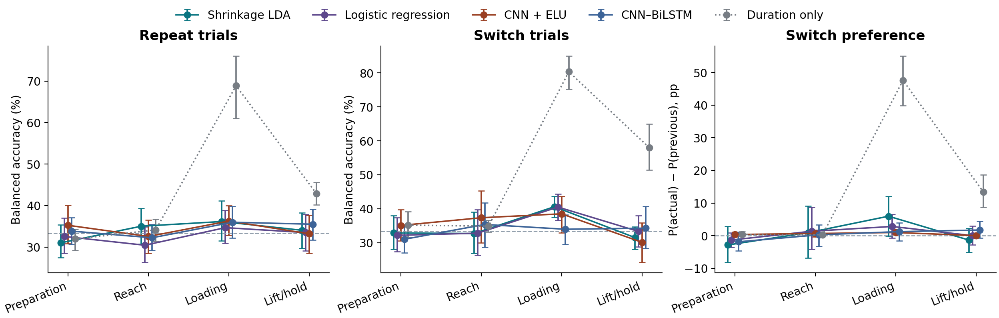

# C_10 — Weight decoding by stage on repeat and switch trials

Within-participant models across P1–P12 at fixed sandpaper. The matched analysis retained 775 training, 382 validation and 769 held-out trials. The held-out set contains 494 repeats and 275 switches. There is one 64 ms EEG segment for each stage of each included trial.

## Main findings

Both linear EEG models reached about 41% balanced accuracy on loading-stage switches, compared with the 33.33% reference. CNN + ELU reached 38.5% and CNN–BiLSTM 34.0%. Loading duration alone reached 80.3% on switches and 68.9% on repeats.

No EEG classifier showed a clear preference for previous weight before contact. At loading, CNN + ELU gave the actual weight a 1.0 percentage point advantage over the previous weight (exploratory interval +0.3 to +1.6 pp). All four paired loading-minus-reach intervals crossed zero. The data give limited stage-specific evidence on this schedule and cannot establish that participants expected the last weight or that EEG adds information beyond duration.

## Switch trials

Balanced accuracy is in percent. Switch preference is the model probability of the actual weight minus that of the previous weight, in percentage points. Positive values favour actual weight. Preference gives equal weight to the six directed transitions within each participant. Intervals are exploratory 95% percentile bootstrap intervals over the 12 participant estimates.

| Decoder | Preparation balanced accuracy | Reach | Loading | Lift/hold |
| --- | ---: | ---: | ---: | ---: |
| Shrinkage LDA | 32.9 [28.1, 38.0] | 32.7 [26.9, 39.0] | 40.6 [37.5, 43.6] | 31.5 [28.1, 34.7] |
| Multinomial logistic regression | 32.2 [27.4, 37.3] | 32.8 [26.3, 39.8] | 40.5 [36.6, 44.3] | 33.3 [28.8, 38.0] |
| CNN + ELU | 35.1 [30.5, 39.7] | 37.4 [30.0, 45.2] | 38.5 [32.9, 43.7] | 30.1 [24.2, 35.8] |
| CNN–BiLSTM | 31.0 [27.0, 35.1] | 35.4 [28.7, 41.8] | 34.0 [29.5, 38.2] | 34.3 [28.3, 40.7] |
| Stage duration only | 35.2 [31.6, 39.2] | 34.9 [33.1, 36.6] | 80.3 [75.2, 84.9] | 58.0 [51.4, 64.9] |
| Previous weight | 0.0 [0.0, 0.0] | 0.0 [0.0, 0.0] | 0.0 [0.0, 0.0] | 0.0 [0.0, 0.0] |
| Schedule lookup | 100.0 [100.0, 100.0] | 100.0 [100.0, 100.0] | 100.0 [100.0, 100.0] | 100.0 [100.0, 100.0] |

| Decoder | Preparation preference | Reach | Loading | Lift/hold | Loading − reach | Lift/hold − preparation |
| --- | ---: | ---: | ---: | ---: | ---: | ---: |
| Shrinkage LDA | -2.9 [-8.3, +2.8] | +0.9 [-6.9, +9.1] | +6.0 [-0.2, +12.1] | -1.4 [-5.1, +2.2] | +5.0 [-0.2, +10.3] | +1.5 [-5.4, +8.1] |
| Multinomial logistic regression | -1.4 [-3.5, +0.9] | +1.3 [-4.2, +8.7] | +2.8 [-0.7, +6.5] | -0.0 [-2.8, +2.9] | +1.5 [-5.4, +6.8] | +1.4 [-2.9, +5.6] |
| CNN + ELU | +0.3 [-0.4, +1.1] | +0.6 [-0.3, +1.7] | +1.0 [+0.3, +1.6] | +0.0 [-0.6, +0.7] | +0.3 [-0.9, +1.4] | -0.3 [-1.4, +0.6] |
| CNN–BiLSTM | -1.9 [-4.7, +1.2] | +0.3 [-3.4, +3.4] | +1.2 [-1.5, +3.9] | +1.7 [-0.7, +4.5] | +1.0 [-3.5, +5.6] | +3.6 [-0.4, +7.4] |
| Stage duration only | +0.3 [-0.2, +1.2] | +0.3 [+0.0, +0.5] | +47.6 [+39.8, +55.0] | +13.4 [+8.7, +18.6] | +47.3 [+39.7, +54.7] | +13.1 [+8.1, +18.4] |
| Previous weight | -100.0 [-100.0, -100.0] | -100.0 [-100.0, -100.0] | -100.0 [-100.0, -100.0] | -100.0 [-100.0, -100.0] | +0.0 [+0.0, +0.0] | +0.0 [+0.0, +0.0] |
| Schedule lookup | +100.0 [+100.0, +100.0] | +100.0 [+100.0, +100.0] | +100.0 [+100.0, +100.0] | +100.0 [+100.0, +100.0] | +0.0 [+0.0, +0.0] | +0.0 [+0.0, +0.0] |

## Repeat trials

| Decoder | Preparation balanced accuracy | Reach | Loading | Lift/hold |
| --- | ---: | ---: | ---: | ---: |
| Shrinkage LDA | 31.0 [27.5, 35.3] | 35.0 [30.8, 39.3] | 36.1 [31.5, 41.2] | 34.0 [29.7, 38.2] |
| Multinomial logistic regression | 32.6 [28.5, 37.0] | 30.4 [26.3, 34.9] | 34.7 [31.0, 38.8] | 33.5 [29.1, 37.9] |
| CNN + ELU | 35.2 [30.8, 40.1] | 32.6 [28.5, 36.6] | 36.3 [32.9, 40.0] | 33.2 [28.5, 37.7] |
| CNN–BiLSTM | 33.8 [30.7, 37.1] | 32.2 [29.2, 35.5] | 36.0 [32.2, 39.8] | 35.5 [31.7, 39.1] |
| Stage duration only | 31.9 [29.2, 34.3] | 34.1 [31.4, 36.7] | 68.9 [61.0, 76.0] | 42.9 [40.2, 45.6] |
| Previous weight | 100.0 [100.0, 100.0] | 100.0 [100.0, 100.0] | 100.0 [100.0, 100.0] | 100.0 [100.0, 100.0] |
| Schedule lookup | 100.0 [100.0, 100.0] | 100.0 [100.0, 100.0] | 100.0 [100.0, 100.0] | 100.0 [100.0, 100.0] |

## Evaluation and limits

The uniform three-class balanced-accuracy reference is 33.33%. The previous-weight rule gives 100% on repeats and 0% on switches by construction. A lookup fitted to cohort training metadata using trial number and the previous weight maps all 769 held-out trials correctly. The same repeat/switch schedule occurs throughout the selected series. The lookup measures schedule predictability. The EEG decoders receive no sequence or duration metadata. The separate duration-only control uses the observed end of each stage and is retrospective.

A pre-contact preference can reflect carryover or advance knowledge. A loading signal can include movement, force, sensory feedback or artifacts. The short retrospective segments were centred on event-defined stages. The bootstrap describes variability across these participants for this fixed schedule and split. Separate intervals do not adjust for multiple model and stage comparisons. Neural results use one seed. The CNNs reuse the project layer stacks with 32-sample inputs and three-class outputs, trained on CPU with Keras 3.9.2 and PyTorch 2.7.1.

The numbers for heavier/lighter switches and for prior same-weight streak lengths 1–3 are descriptive, with trial counts recorded in the local analysis. Each subgroup row reports trial-pooled accuracy. Trial history is the number of consecutive previous trials at the immediately previous weight. The schedule never repeats after a prior streak of four.

## Verification

The extraction verified raw EEG and wrist samples at all 2,040 trial clocks. An independent read of the condition-audit CSV agreed with all 1,980 current/previous labels used to construct the matched sets. The aggregation checked unique test keys, exact matched trial sets, class order, probability sums and the schedule baseline.

[Protocol](PROTOCOL.md) · [Summary](summary.json) · [Verification](verification.json) · [Independent verification](independent_verification.json)
