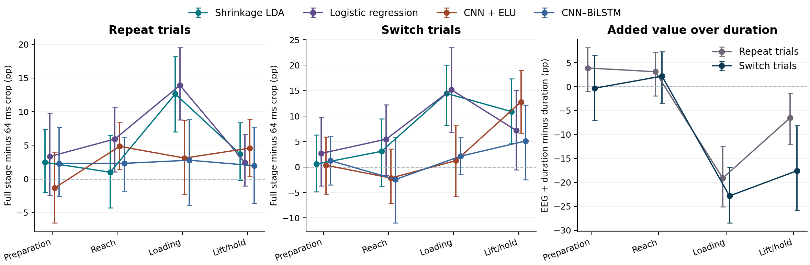

# C_10 — Full-stage EEG against the 64 ms crop

P1–P12 share the same 769 test trials across the two representations, with 494 repeats and 275 switches. Each participant and stage has its own fit. The full-stage model uses 32 bins from the full EEG stage. See the linked protocol for the matched split, features and models.

## Findings

On loading-stage switches, full-stage EEG increased balanced accuracy from 40.6% to 55.0% for shrinkage LDA and from 40.5% to 55.7% for logistic regression. The paired 95% exploratory intervals for those gains are +8.2 to +20.0 and +6.8 to +23.4 percentage points. CNN + ELU showed its clearest gain during lift/hold, from 30.1% to 42.9%. All paired switch accuracy intervals for CNN–BiLSTM included zero.

Actual-weight preference was clearer after contact. Before contact, the full-stage intervals included zero for all four models. The post-contact results are compatible with movement, force or sensory feedback, and the shared schedule limits inference about expectation.

On loading-stage switches, duration alone scored 80.3% balanced accuracy, versus 57.5% for EEG plus duration. Adding the EEG features in this logistic setup also worsened class-balanced log loss at loading and lift/hold. This tests the incremental value of these features in a particular fitted model and evaluation split.

The tables show percentage-point changes in balanced accuracy. Positive values favour full-stage features or EEG plus duration. Brackets are exploratory 95% paired participant-bootstrap intervals.

## Repeat trial balanced accuracy

| Model | Preparation | Reach | Loading | Lift/hold |
| --- | ---: | ---: | ---: | ---: |
| Shrinkage LDA | +2.5 [-2.0, +7.4] | +1.0 [-4.3, +6.5] | +12.6 [+7.0, +18.2] | +3.7 [-0.2, +8.4] |
| Logistic regression | +3.3 [-2.4, +9.8] | +5.9 [+1.1, +10.6] | +13.9 [+8.8, +19.5] | +2.4 [-1.0, +6.6] |
| CNN + ELU | -1.3 [-6.5, +4.0] | +4.8 [+1.4, +8.4] | +3.1 [-2.3, +8.7] | +4.6 [+0.3, +8.9] |
| CNN–BiLSTM | +2.3 [-2.6, +7.7] | +2.3 [-1.8, +6.1] | +2.8 [-3.9, +8.8] | +2.0 [-3.6, +7.7] |

## Switch trial balanced accuracy

| Model | Preparation | Reach | Loading | Lift/hold |
| --- | ---: | ---: | ---: | ---: |
| Shrinkage LDA | +0.6 [-4.9, +6.3] | +3.1 [-3.9, +9.5] | +14.5 [+8.2, +20.0] | +10.9 [+4.7, +17.3] |
| Logistic regression | +2.7 [-3.7, +9.7] | +5.5 [-1.6, +12.2] | +15.2 [+6.8, +23.4] | +7.2 [-0.5, +15.0] |
| CNN + ELU | +0.3 [-5.3, +5.9] | -2.2 [-7.2, +3.5] | +1.2 [-5.8, +8.1] | +12.8 [+6.6, +19.0] |
| CNN–BiLSTM | +1.2 [-3.5, +6.0] | -2.4 [-11.0, +5.7] | +2.1 [-1.5, +5.8] | +5.1 [-2.5, +12.2] |

## EEG plus duration versus duration alone

| Trial group | Preparation | Reach | Loading | Lift/hold |
| --- | ---: | ---: | ---: | ---: |
| Repeat | +3.9 [-1.0, +8.1] | +3.1 [-1.9, +7.1] | -19.1 [-25.1, -12.4] | -6.5 [-12.1, -1.3] |
| Switch | -0.3 [-7.1, +6.5] | +2.2 [-3.5, +7.3] | -22.8 [-28.5, -16.8] | -17.6 [-25.8, -8.2] |

Positive log-loss changes indicate worse class-probability predictions. The fully paired log-loss outcomes, all switch preference comparisons, and absolute metrics are in the JSON results.

## Full-stage switch probability preference

Mean P(actual) minus P(previous), in percentage points. Each of the six directed switches contributes equally within each participant.

| Model | Preparation | Reach | Loading | Lift/hold |
| --- | ---: | ---: | ---: | ---: |
| Shrinkage LDA | -5.3 [-14.7, +3.7] | +3.8 [-3.4, +11.1] | +31.4 [+21.7, +41.2] | +14.9 [+8.4, +21.6] |
| Logistic regression | -2.7 [-7.2, +1.6] | +0.9 [-4.1, +5.8] | +18.6 [+13.1, +24.1] | +10.4 [+5.8, +15.1] |
| CNN + ELU | -0.1 [-0.8, +0.9] | +0.0 [-0.9, +1.1] | +1.5 [+0.7, +2.3] | +1.5 [+0.6, +2.3] |
| CNN–BiLSTM | -0.7 [-6.0, +4.6] | -0.6 [-3.3, +2.3] | +2.4 [-0.8, +5.6] | +1.8 [-0.5, +4.1] |

The original experiment’s schedule and duration limitations still apply. EEG summaries may encode stage duration indirectly because bins of different lengths average different numbers of samples. The timing control is available after stage completion. These results compare feature representations on this held-out split.

[Protocol](PROTOCOL.md) · [Paired comparisons](paired_comparison.json) · [Stage metrics](summary.json) · [Independent verification](independent_verification.json) · [Original 64 ms run](../c10-stage-weight-20261114/RESULTS.md)
