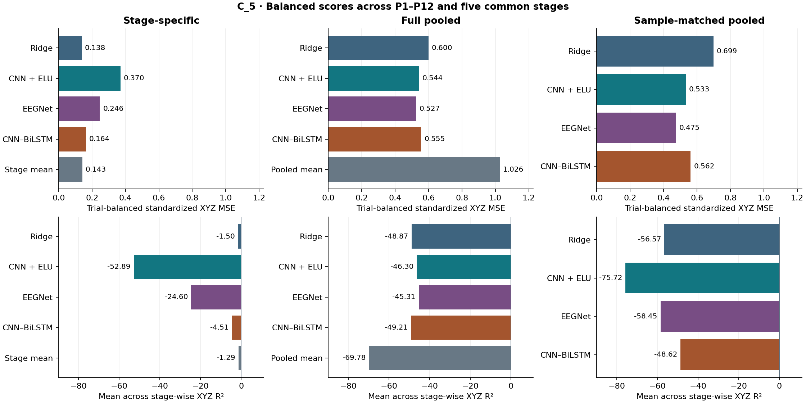

# C_5 — Stage-specific and pooled wrist decoders

Ridge and three CNN architectures. Pure-stage windows, 2 ms lead, held-out series 8–9. The balanced scores use the same participants, stages and test targets across models.

Common stages: Preparation, Reach, Lift/hold, Lowering, Return.

First score each stage with equal trial weight, then average stages within participant and participants equally. R² uses the held-out trial-weighted mean for each axis as its reference. Positive R² beats that reference. MSE uses training-standardized wrist coordinates.

## Findings

Every specialist architecture lowered balanced MSE relative to its full pooled counterpart. The paired 95% exploratory intervals excluded zero. CNN–BiLSTM led the CNN specialists at 0.1635 MSE. Ridge was lowest at 0.1382, close to the training-stage mean at 0.1428 (difference −0.0046, exploratory interval −0.0180 to +0.0134).

All balanced R² averages were negative. Each R² is relative to the variation within one held-out stage and participant. Stages with little variation can yield large negative values, even when their MSE is small. Use the per-stage and per-axis results to see where this occurs.

## Stage-specific decoders

| Decoder | Balanced MSE ↓ | Mean XYZ R² ↑ | R² X | R² Y | R² Z |
| --- | ---: | ---: | ---: | ---: | ---: |
| Ridge | 0.1382 | -1.5045 | -1.8306 | -1.3763 | -1.3066 |
| CNN + ELU | 0.3701 | -52.8901 | -45.2373 | -102.7041 | -10.7289 |
| EEGNet regression | 0.2464 | -24.6021 | -20.5882 | -45.8417 | -7.3765 |
| CNN–BiLSTM | 0.1635 | -4.5132 | -4.0890 | -6.8211 | -2.6296 |
| Stage mean | 0.1428 | -1.2932 | -1.6384 | -1.1124 | -1.1288 |

## Pooled decoders

| Decoder | Balanced MSE ↓ | Mean XYZ R² ↑ | R² X | R² Y | R² Z |
| --- | ---: | ---: | ---: | ---: | ---: |
| Ridge | 0.5999 | -48.8722 | -41.2453 | -65.3659 | -40.0054 |
| CNN + ELU | 0.5442 | -46.3036 | -40.0276 | -66.0235 | -32.8596 |
| EEGNet regression | 0.5270 | -45.3147 | -40.0219 | -65.5518 | -30.3705 |
| CNN–BiLSTM | 0.5555 | -49.2142 | -45.0183 | -77.1212 | -25.5032 |
| Pooled mean | 1.0257 | -69.7785 | -54.2866 | -82.1966 | -72.8523 |

## Sample-matched pooled controls

| Decoder | Balanced MSE ↓ | Mean XYZ R² ↑ | R² X | R² Y | R² Z |
| --- | ---: | ---: | ---: | ---: | ---: |
| Ridge | 0.6992 | -56.5708 | -47.4554 | -74.1654 | -48.0917 |
| CNN + ELU | 0.5329 | -75.7228 | -66.1738 | -138.6123 | -22.3822 |
| EEGNet regression | 0.4749 | -58.4512 | -50.1591 | -103.0881 | -22.1066 |
| CNN–BiLSTM | 0.5617 | -48.6232 | -42.4775 | -76.5835 | -26.8085 |

The CNNs use seed 42 and 15 epochs. Stage R² is sensitive to low within-stage target variance. The strict comparison excludes stages without support for all models and participants. The stage scores include available participants and show support counts. Ridge also retains its target-stage sensitivity results.

Verified 528 CNN fits and 5394 score rows.

[Protocol](PROTOCOL.md) · [Balanced scores](balanced_scores.csv) · [Stage scores](stage_scores.csv) · [Cross-stage specialist scores](cross_stage_scores.csv) · [Paired effects](paired_effects.csv) · [Participant scores](participant_scores.csv) · [Fit manifest](cnn_fit_manifest.csv) · [Independent verification](independent_verification.json)
