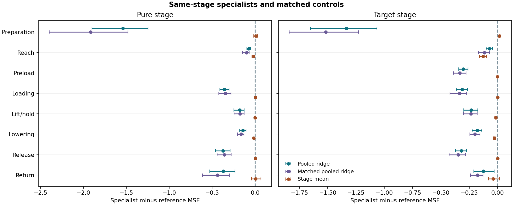
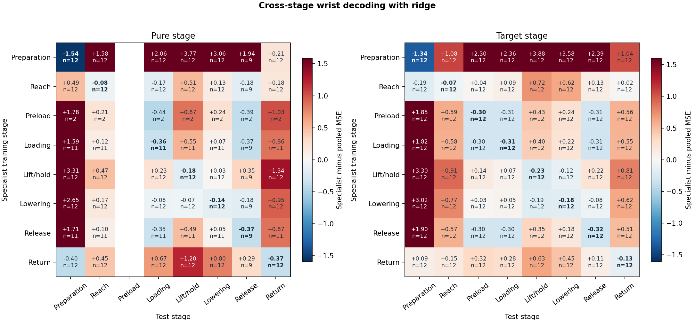

# C_5 — Stage-specific versus pooled wrist-position decoding

P1–P12, ridge, fixed 2 ms prediction lead and 256 ms EEG windows. Models train on series 1–6 and score on series 8–9. Stages come from known event markers.

Values are specialist minus reference XYZ MSE. Negative values favour the specialist. Brackets are exploratory 95% intervals from resampling participants. The same test targets and trials are used within each comparison.

## Findings

Same-stage specialists improved on full pooled ridge and sample-matched pooled ridge across the 12 participants. Under the strict window rule, their average error was close to the stage-specific training mean. Reach and lowering had small gains over that mean, with exploratory intervals below zero. The target-stage sensitivity analysis gave a larger difference from the stage mean, especially during reach, and included earlier-phase EEG for some targets.

A specialist applied to a different stage had higher average MSE than the same-stage specialist on that test stage. The mean cross-stage penalty was 1.231 for pure-stage windows and 1.048 for target-stage windows. Comparisons average available train-stage and test-stage pairs within each participant. Between-stage changes in mean wrist position and movement can contribute to those errors.

Preload had insufficient support for the strict stage-pure ridge comparison. Loading and release had partial participant support. These results cover ridge and known event boundaries.

## Pure stage

| Stage | Participants | Full pooled | Matched pooled | Stage mean |
| --- | ---: | ---: | ---: | ---: |
| Preparation | 12 | -1.5406 [-1.9004, -1.2464] | -1.9167 [-2.3988, -1.4835] | +0.0085 [-0.0160, +0.0271] |
| Reach | 12 | -0.0750 [-0.0963, -0.0532] | -0.1014 [-0.1469, -0.0690] | -0.0193 [-0.0372, -0.0018] |
| Loading | 11 | -0.3582 [-0.4117, -0.3029] | -0.3478 [-0.4234, -0.2816] | +0.0008 [-0.0001, +0.0018] |
| Lift/hold | 12 | -0.1795 [-0.2471, -0.1273] | -0.1779 [-0.2441, -0.1268] | -0.0020 [-0.0059, +0.0009] |
| Lowering | 12 | -0.1425 [-0.1792, -0.1072] | -0.1651 [-0.2034, -0.1311] | -0.0156 [-0.0269, -0.0005] |
| Release | 9 | -0.3733 [-0.4604, -0.2911] | -0.3584 [-0.4439, -0.2777] | +0.0006 [-0.0002, +0.0015] |
| Return | 12 | -0.3708 [-0.5273, -0.2355] | -0.4391 [-0.6131, -0.3012] | +0.0053 [-0.0421, +0.0671] |

Across supported stages within participant, differences were -0.4480 [-0.5339, -0.3786] against full pooled ridge, -0.5251 [-0.6435, -0.4273] against matched pooled ridge and -0.0025 [-0.0129, +0.0121] against the stage mean.

## Target stage

| Stage | Participants | Full pooled | Matched pooled | Stage mean |
| --- | ---: | ---: | ---: | ---: |
| Preparation | 12 | -1.3356 [-1.6522, -1.0654] | -1.5169 [-1.8404, -1.2280] | +0.0158 [+0.0038, +0.0296] |
| Reach | 12 | -0.0706 [-0.0999, -0.0435] | -0.1146 [-0.1677, -0.0701] | -0.1267 [-0.1589, -0.0962] |
| Preload | 12 | -0.3019 [-0.3424, -0.2611] | -0.3329 [-0.3889, -0.2767] | -0.0004 [-0.0019, +0.0009] |
| Loading | 12 | -0.3120 [-0.3639, -0.2656] | -0.3362 [-0.4190, -0.2722] | +0.0007 [+0.0000, +0.0014] |
| Lift/hold | 12 | -0.2315 [-0.2982, -0.1749] | -0.2349 [-0.3001, -0.1795] | -0.0150 [-0.0254, -0.0076] |
| Lowering | 12 | -0.1783 [-0.2242, -0.1399] | -0.1987 [-0.2452, -0.1566] | -0.0258 [-0.0371, -0.0140] |
| Release | 12 | -0.3199 [-0.3706, -0.2740] | -0.3482 [-0.4263, -0.2821] | +0.0012 [+0.0002, +0.0026] |
| Return | 12 | -0.1262 [-0.2098, -0.0302] | -0.1772 [-0.2371, -0.1275] | -0.0377 [-0.0800, +0.0177] |

Across supported stages within participant, differences were -0.3595 [-0.4113, -0.3063] against full pooled ridge, -0.4075 [-0.4574, -0.3572] against matched pooled ridge and -0.0235 [-0.0329, -0.0139] against the stage mean.

Pure stage requires the full input window and target to fall in the same stage of the same trial. The target-stage sensitivity comparison retains preceding-phase context. Short stages can lack support under the purity rule. The cross-stage matrix reports separate improvement relative to the pooled model for each test stage. Each cell can contain a different number of participants.

The matched pooled models have the same number of training windows and exact recording-series, weight and surface counts as the specialist. The pooled sampler may include samples from the specialist stage. Stage means use training targets only. Trial-balanced test scores give trials equal weight within each cell. Stage duration, kinematics and EEG preprocessing may contribute to differences. The stage coverage table records target variance, median speed and condition counts.

Checked 3,120 trial clocks across 96 series and 1,104 ridge fits. Excluded 39 trials with unusable event order or timestamps.

[Protocol](PROTOCOL.md) · [Paired scores](paired_effects.csv) · [Cross-stage scores](metrics.csv) · [Coverage](stage_coverage.csv) · [Summary](population_summary.json) · [Verification](verification.json) · [Independent aggregation check](independent_verification.json)
