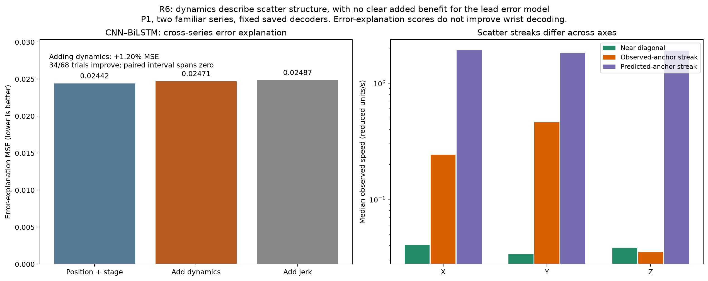
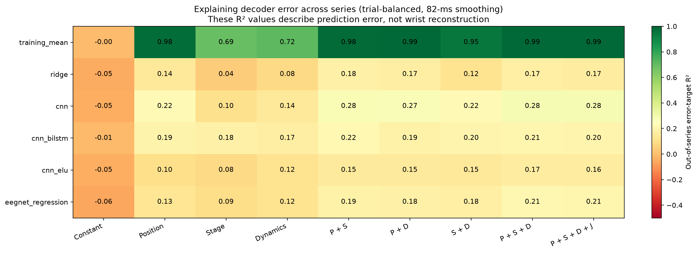
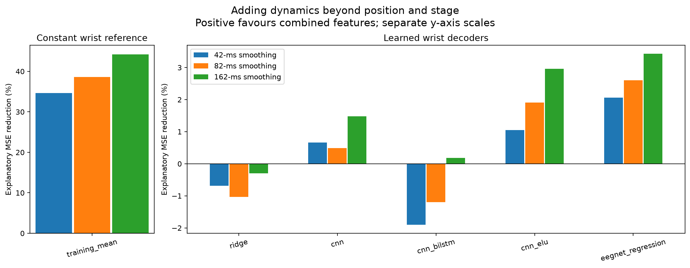
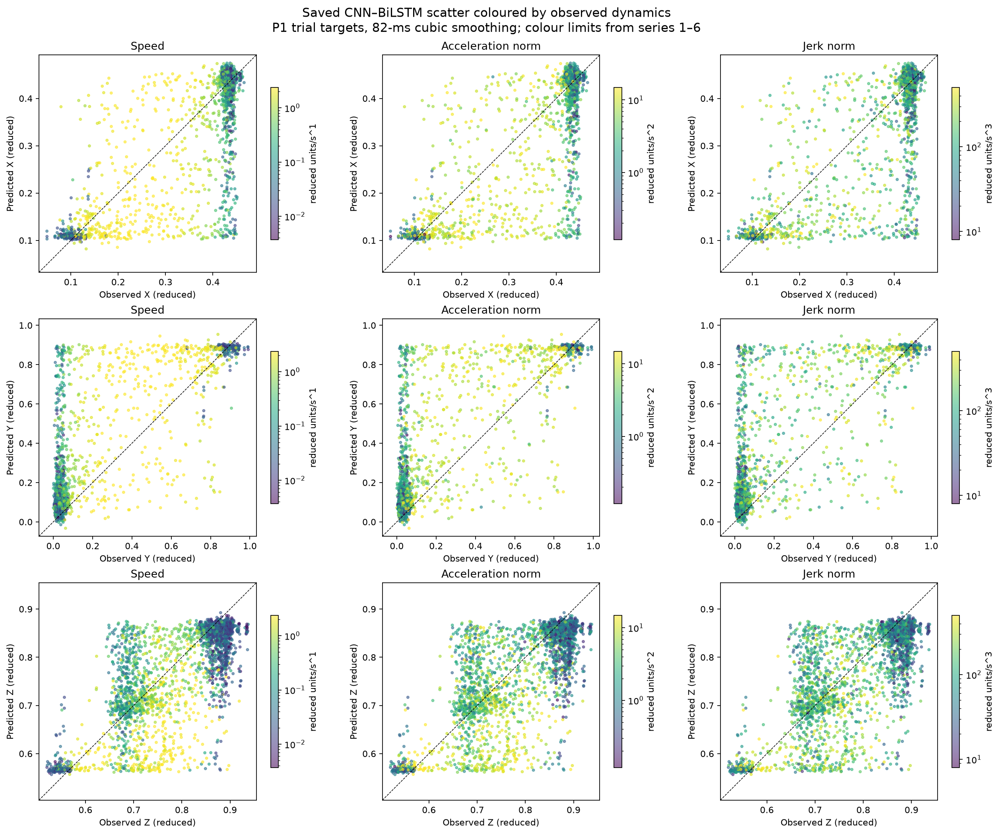
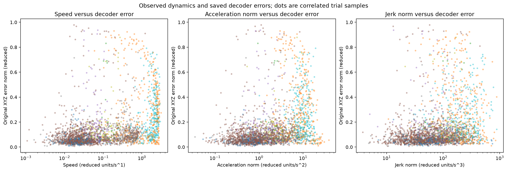
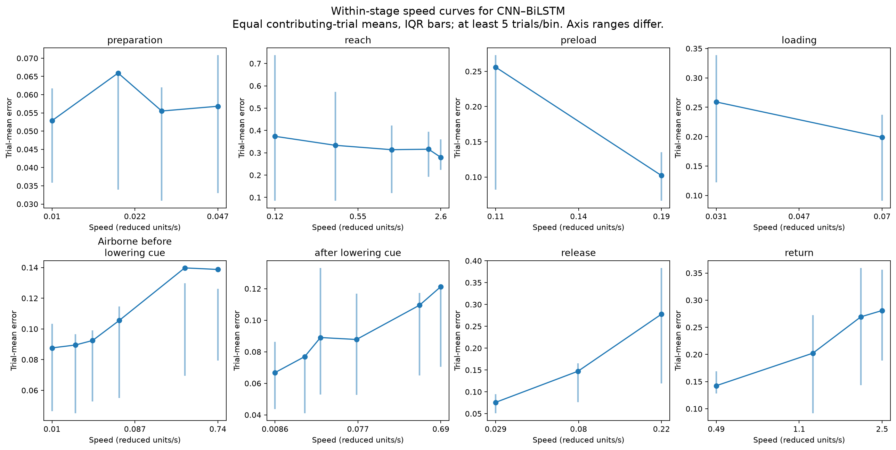
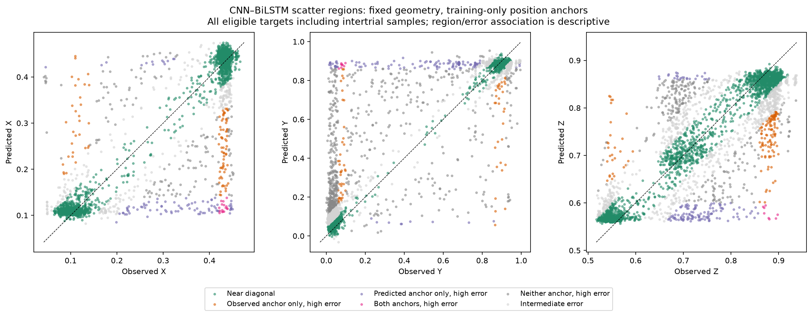

# EXP-036: movement dynamics and saved-decoder error

**Finding:** speed helps describe some scatter streaks, but the declared dynamics
features do not show clear additional error-explanation value for CNN–BiLSTM
after accounting for position and stage. Event stages remain useful candidates
for follow-up; this result does not establish a dynamics-only replacement.

P1 series 8–9 contribute **2,657 trial targets from 68 trials**, evaluated with
six frozen decoders. One recording-edge target is excluded from the descriptive
full-recording plots, leaving 3,641 targets including intertrial samples.
No wrist decoder was trained or rerun. The 324 small explanatory ridge fits
train on one series and evaluate on the other, with equal total weight per trial.

## What the new analysis adds

1. **The primary contrast is inconclusive for an added dynamics benefit.**
   Adding velocity/speed and acceleration to position/stage changes lead-model
   explanatory MSE from **0.024421 to 0.024714**, a **1.20% worsening**. Both
   evaluation series worsen at the primary 82-ms smoothing setting; 34/68
   individual trials improve. The paired loss difference is +0.000293, with
   an exploratory block-4 95% interval **[-0.000332, +0.000888]**. Blocks 2/8
   also span zero. This is not evidence of equivalence or absence of all
   dynamics information.
2. **The scatter streaks are not explained by one speed rule.** Near-diagonal
   median speeds are 0.0406 / 0.0339 / 0.0383 reduced units/s for X/Y/Z.
   High-error predicted-anchor streaks have medians 1.93 / 1.82 / 1.91.
   Observed-anchor streaks differ: X 0.242, Y 0.461, but **Z 0.0351**, close
   to its near-diagonal group. Z's vertical streak therefore includes slow
   movement. Only 25–29% of near-diagonal points fall below the fixed 0.02
   low-speed threshold. Geometric group definitions already involve error,
   so these are composition descriptions, not independent predictive gains.
3. **The speed relationship depends on stage.** Within-stage Spearman
   associations for the lead model range from reach **0.014** to return
   **0.293** and release **0.316**. These correlated-sample associations are
   descriptive, without independent-window significance claims. Sparse
   preload/release coverage and different speed ranges limit comparisons.
4. **Results depend on the decoder and smoothing.** For the lead decoder,
   added-dynamics MSE reductions are -1.90%, -1.20% and +0.18% at 42/82/162 ms.
   At the primary setting, the other learned decoders range from -1.03% to
   +2.61%. Jerk does not improve the primary lead-model result. The large
   relative gain for the constant wrist reference concerns an already tiny
   unexplained-error residual (error-target R² about 0.98 to 0.99). That
   reference has no sample-dependent EEG input, illustrating why movement/error
   association alone cannot demonstrate a neural mechanism.

## Error-explanation scores

These are scores for predicting the **original decoder's error magnitude**,
not improved wrist reconstruction. Observed kinematics are retrospective
features. Primary smoothing is 82 ms, cubic polynomial; ridge alpha is fixed
at 10 with no tuning. The numerical conclusions apply to this feature basis,
regularization and two-series evaluation, not every possible nonlinear model.

| Features | Trial-balanced MSE | Error-target R² |
|---|---:|---:|
| constant | 0.031532 | -0.011 |
| position | 0.025205 | 0.192 |
| stage | 0.025578 | 0.180 |
| dynamics | 0.025831 | 0.172 |
| position_stage | 0.024421 | 0.217 |
| position_dynamics | 0.025258 | 0.191 |
| stage_dynamics | 0.024868 | 0.203 |
| combined | 0.024714 | 0.208 |
| combined_jerk | 0.024866 | 0.203 |

## Scatter structure and stage-specific speed relationships

Speed bins come from original training series 1–6. Curves average contributing
trial means; bars show their interquartile range, not confidence intervals.
At least five trials must contribute. Axis ranges differ between stages.

Reduced units and per-axis upstream rescaling prevent physical speed or
anatomical-direction claims. Differentiation is symmetric and retrospective.
Unknown upstream processing, reused test data, one participant, a fixed
explanatory family and limited trial coverage remain material limitations.
Trial-block intervals condition on the fitted explainers and omit refitting,
seed and population uncertainty.

## Next decision

Retain **C7 retrospective stage classification** as the next planned experiment,
then C5's direct pooled-versus-stage-specific regression comparison. The new
analysis does not by itself prove a need for separate decoders, distinct neural
populations, an automatic regime detector or an online error predictor. It
also does not justify switching the existing wrist decoder or retuning it on
these test samples. C7 and C5 should treat stage and dynamics as complementary
questions rather than requiring a successful classifier before regression.

## Reproduction and evidence

- `results.json`: all 162 feature-set/model/window summaries and both series folds.
- `explanatory_trials.csv`: 11,016 paired trial-metric rows.
- `primary_paired_trials.csv`: 68 primary combined-minus-position/stage losses.
- `stage_trial_dynamics.csv`, `within_stage_correlations.csv`, `speed_bins.csv`: stage coverage and dynamics summaries.
- `scatter_regions.csv`, `scatter_region_trials.csv`: fixed geometric region composition.
- `analysis_data.npz`, `fitted_explainers.npz`: local arrays, out-of-series predictions and fit parameters, ignored by Git.
- Exact analysis/helper/protocol and verifier snapshots are retained. Plot-only repairs have a separate `render_source.py` and `plot_rendering.json` receipt.
- [Independent verification](verification.json) checks sources, derivatives, train-only scaling, all 324 coefficient replays and ridge stationarity equations, 486 metric sets, trial/stage/bin tables, geometric definitions and three bootstrap intervals. No verifier fitting occurs.

[Declared protocol](../../documentation/methods/ERROR_DYNAMICS.md) · [Registry](../../documentation/EXPERIMENT_REGISTRY.md)
