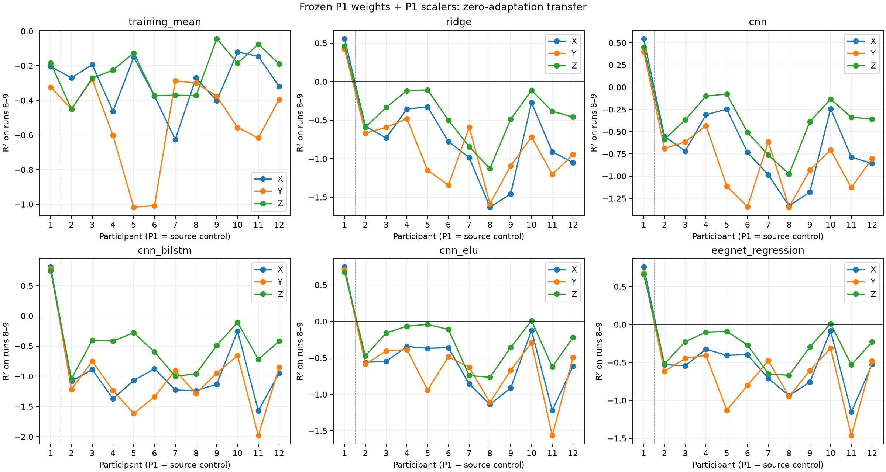

# P1-trained, zero-adaptation cross-participant evaluation

All six saved models and P1 training scalers are frozen. No target fitting, validation selection, batch-normalization updates or fine-tuning.
Raw P1–P12 recordings verify wrist X/Y/Z provenance. Inference uses the same reduced data representation as the source experiment.
Primary: runs 8–9 of P2–P12, with P1 runs 8–9 as a replay control. Secondary: all nine runs of each target participant.

## Findings

The strong P1 results do not transfer reliably with frozen weights and P1 scalers.
Every model/axis participant-macro R² is negative on runs 8–9. The frozen P1
training mean outperforms every learned model on those macro averages, although
individual participant/axis comparisons vary. CNN–BiLSTM leads within P1 but has
the poorest cross-participant macro scores among the six models. Only P10 Z is
slightly positive for CNN + ELU (0.0106) and EEGNet (0.0121).

Runs 8–9 are weight series with fixed sandpaper in every participant, so this
primary comparison does not mix surface labels. It includes 45,389 target windows;
all-run secondary evaluation includes 281,267. All-run model/axis macro averages
also remain negative, despite a few small positive individual scores.

All twelve raw/reduced checks confirm wrist X/Y/Z identity, with minimum Pearson
r = 0.9999231 across 36 participant/axis pairs. P1 control predictions preserve
the saved scores within recorded GPU tolerances, and source models/scalers are
unchanged. These findings demonstrate poor transfer under the existing reduced
representation; they do not identify whether EEG normalization, participant
mapping, target coordinates or other upstream processing is the dominant cause.

## Participant-macro R² on runs 8–9

Each participant receives equal weight. P1 is excluded from the macro summary.

| Model | Mean X | Mean Y | Mean Z | Median X | Median Y | Median Z |
|---|---:|---:|---:|---:|---:|---:|
| training_mean | -0.3035 | -0.5350 | -0.2439 | -0.2708 | -0.4492 | -0.2248 |
| ridge | -0.8247 | -0.9428 | -0.4608 | -0.7775 | -0.9465 | -0.4599 |
| cnn | -0.7222 | -0.8840 | -0.4179 | -0.7337 | -0.8034 | -0.3679 |
| cnn_bilstm | -1.0595 | -1.1627 | -0.5847 | -1.0833 | -1.2168 | -0.4897 |
| cnn_elu | -0.6406 | -0.6873 | -0.3221 | -0.5605 | -0.5848 | -0.2203 |
| eegnet_regression | -0.5785 | -0.6984 | -0.3242 | -0.5290 | -0.6087 | -0.2703 |

## Participant results on runs 8–9

| Participant | Model | Windows | R² X | R² Y | R² Z |
|---|---|---:|---:|---:|---:|
| P1 | training_mean | 3642 | -0.2044 | -0.3242 | -0.1847 |
| P1 | ridge | 3642 | 0.5581 | 0.4203 | 0.4616 |
| P1 | cnn | 3642 | 0.5466 | 0.3994 | 0.4511 |
| P1 | cnn_bilstm | 3642 | 0.8092 | 0.7829 | 0.7484 |
| P1 | cnn_elu | 3642 | 0.7465 | 0.7126 | 0.6775 |
| P1 | eegnet_regression | 3642 | 0.7577 | 0.6830 | 0.6628 |
| P2 | training_mean | 4642 | -0.2699 | -0.4492 | -0.4509 |
| P2 | ridge | 4642 | -0.5773 | -0.6682 | -0.5917 |
| P2 | cnn | 4642 | -0.5542 | -0.6886 | -0.5865 |
| P2 | cnn_bilstm | 4642 | -1.0833 | -1.2168 | -1.0395 |
| P2 | cnn_elu | 4642 | -0.5605 | -0.5848 | -0.4719 |
| P2 | eegnet_regression | 4642 | -0.5290 | -0.6161 | -0.5176 |
| P3 | training_mean | 3543 | -0.1939 | -0.2784 | -0.2723 |
| P3 | ridge | 3543 | -0.7319 | -0.5929 | -0.3339 |
| P3 | cnn | 3543 | -0.7177 | -0.6149 | -0.3679 |
| P3 | cnn_bilstm | 3543 | -0.8888 | -0.7514 | -0.4045 |
| P3 | cnn_elu | 3543 | -0.5478 | -0.4051 | -0.1579 |
| P3 | eegnet_regression | 3543 | -0.5427 | -0.4464 | -0.2258 |
| P4 | training_mean | 3796 | -0.4628 | -0.6027 | -0.2248 |
| P4 | ridge | 3796 | -0.3553 | -0.4814 | -0.1170 |
| P4 | cnn | 3796 | -0.3086 | -0.4318 | -0.0995 |
| P4 | cnn_bilstm | 3796 | -1.3701 | -1.2359 | -0.4173 |
| P4 | cnn_elu | 3796 | -0.3432 | -0.3860 | -0.0652 |
| P4 | eegnet_regression | 3796 | -0.3260 | -0.4058 | -0.0994 |
| P5 | training_mean | 4080 | -0.1505 | -1.0164 | -0.1264 |
| P5 | ridge | 4080 | -0.3284 | -1.1511 | -0.1077 |
| P5 | cnn | 4080 | -0.2476 | -1.1135 | -0.0770 |
| P5 | cnn_bilstm | 4080 | -1.0710 | -1.6163 | -0.2776 |
| P5 | cnn_elu | 4080 | -0.3688 | -0.9410 | -0.0408 |
| P5 | eegnet_regression | 4080 | -0.4049 | -1.1297 | -0.0897 |
| P6 | training_mean | 4258 | -0.3755 | -1.0079 | -0.3723 |
| P6 | ridge | 4258 | -0.7775 | -1.3422 | -0.5016 |
| P6 | cnn | 4258 | -0.7337 | -1.3433 | -0.5097 |
| P6 | cnn_bilstm | 4258 | -0.8742 | -1.3418 | -0.5967 |
| P6 | cnn_elu | 4258 | -0.3596 | -0.4843 | -0.1096 |
| P6 | eegnet_regression | 4258 | -0.3973 | -0.8021 | -0.2703 |
| P7 | training_mean | 4349 | -0.6260 | -0.2874 | -0.3698 |
| P7 | ridge | 4349 | -0.9852 | -0.5911 | -0.8447 |
| P7 | cnn | 4349 | -0.9845 | -0.6151 | -0.7622 |
| P7 | cnn_bilstm | 4349 | -1.2260 | -0.9039 | -1.0021 |
| P7 | cnn_elu | 4349 | -0.8586 | -0.6291 | -0.7418 |
| P7 | eegnet_regression | 4349 | -0.7098 | -0.4743 | -0.6484 |
| P8 | training_mean | 3865 | -0.2708 | -0.2995 | -0.3722 |
| P8 | ridge | 3865 | -1.6284 | -1.5841 | -1.1275 |
| P8 | cnn | 3865 | -1.3343 | -1.3487 | -0.9753 |
| P8 | cnn_bilstm | 3865 | -1.2392 | -1.2865 | -0.9579 |
| P8 | cnn_elu | 3865 | -1.1369 | -1.1108 | -0.7669 |
| P8 | eegnet_regression | 3865 | -0.9375 | -0.9465 | -0.6699 |
| P9 | training_mean | 3954 | -0.4023 | -0.3758 | -0.0433 |
| P9 | ridge | 3954 | -1.4571 | -1.0913 | -0.4873 |
| P9 | cnn | 3954 | -1.1792 | -0.9309 | -0.3892 |
| P9 | cnn_bilstm | 3954 | -1.1305 | -0.9465 | -0.4897 |
| P9 | cnn_elu | 3954 | -0.9135 | -0.6702 | -0.3558 |
| P9 | eegnet_regression | 3954 | -0.7584 | -0.6087 | -0.2967 |
| P10 | training_mean | 3983 | -0.1208 | -0.5563 | -0.1856 |
| P10 | ridge | 3983 | -0.2708 | -0.7191 | -0.1135 |
| P10 | cnn | 3983 | -0.2408 | -0.7068 | -0.1339 |
| P10 | cnn_bilstm | 3983 | -0.2495 | -0.6562 | -0.1065 |
| P10 | cnn_elu | 3983 | -0.1232 | -0.2913 | 0.0106 |
| P10 | eegnet_regression | 3983 | -0.0831 | -0.3106 | 0.0121 |
| P11 | training_mean | 4229 | -0.1460 | -0.6176 | -0.0757 |
| P11 | ridge | 4229 | -0.9099 | -1.2023 | -0.3842 |
| P11 | cnn | 4229 | -0.7865 | -1.1274 | -0.3375 |
| P11 | cnn_bilstm | 4229 | -1.5732 | -1.9834 | -0.7205 |
| P11 | cnn_elu | 4229 | -1.2188 | -1.5669 | -0.6231 |
| P11 | eegnet_regression | 4229 | -1.1524 | -1.4643 | -0.5312 |
| P12 | training_mean | 4690 | -0.3197 | -0.3943 | -0.1896 |
| P12 | ridge | 4690 | -1.0499 | -0.9465 | -0.4599 |
| P12 | cnn | 4690 | -0.8566 | -0.8034 | -0.3582 |
| P12 | cnn_bilstm | 4690 | -0.9488 | -0.8508 | -0.4199 |
| P12 | cnn_elu | 4690 | -0.6154 | -0.4909 | -0.2203 |
| P12 | eegnet_regression | 4690 | -0.5218 | -0.4783 | -0.2296 |

## Verification

P1 replay agrees with saved targets, predictions and scores. Metrics were recomputed from all saved prediction files. Neural weights and source artifacts remained unchanged.
Complete per-run scores, friction metadata, provenance evidence and all-run summaries are in results.json; participant_metrics.csv provides a compact numeric table.

Metadata clarification: archived `friction_levels` fields contain `CurS` surface
codes, not `BlockType` series types. The later C1 audit verifies fixed-sandpaper
weight series for these test runs. Numeric scores and archived source snapshots
are unchanged.

An [independent verification](verification.json) recomputed all primary,
all-run and individual-run metrics from 72 saved prediction files (750 metric
subsets), checked every run's target indices, and confirmed source and experiment
snapshot hashes. Neural weights were checked bitwise after each participant by
the inference runner. P1 GPU LSTM replay has maximum/mean prediction differences
of approximately 0.00558/0.000055 standardized units; the report records the
separate prediction and aggregate-score tolerances.
Raw prediction arrays and model checkpoints remain local and ignored by Git.

## Interpretation limits

- One source participant and one trained seed; this is not population/LOPO evaluation.
- Target-participant scores are evaluation only, not model selection or adaptation.
- All-run target scores and P1 held-out-run scores measure different run compositions.
- Run IDs alone do not ensure matched friction; report each participant's metadata.
- Existing reduced EEG and targets have undocumented upstream processing; target values are range-scaled per participant.
- Frozen downstream scalers do not remove upstream participant-wide normalization or recover physical units.
- Overlapping windows are correlated; participant macro summaries are descriptive, not independent-window confidence intervals.
