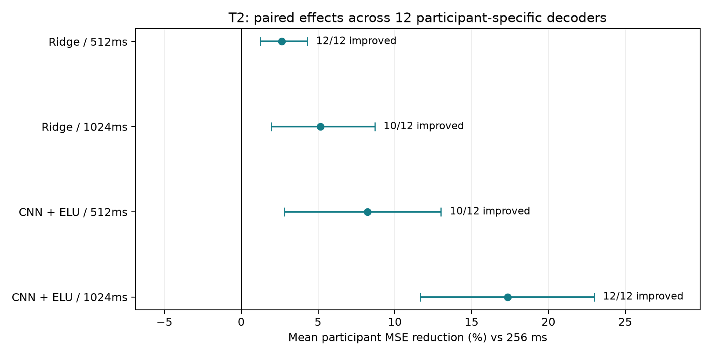
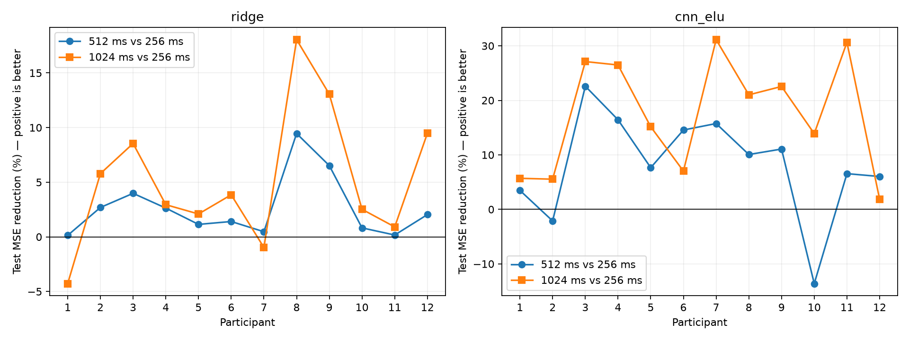
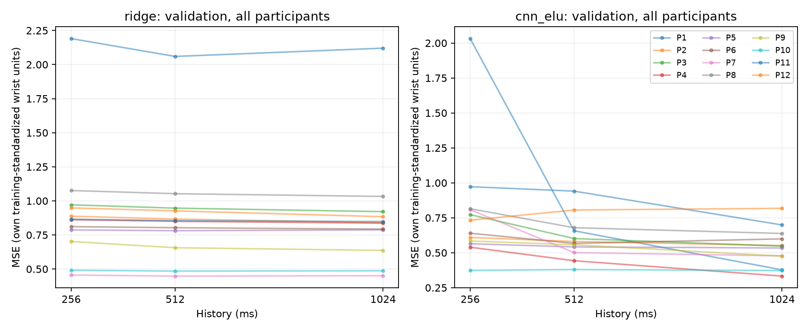

# EXP-018: EEG history duration across P1–P12

## Interpretation and participant-level scope

All 12 participants completed both models at all three histories. These are independent within-participant training runs, followed by equal-weight participant summaries. No pooled or unseen-participant decoder was trained.

**Ridge:** 512 ms: mean participant MSE reduction +2.62% (exploratory 95% interval [1.24, 4.31]); 12/12 participants improve. 1024 ms: mean participant MSE reduction +5.17% (exploratory 95% interval [1.94, 8.70]); 10/12 participants improve.

**CNN + ELU:** 512 ms: mean participant MSE reduction +8.20% (exploratory 95% interval [2.81, 13.01]); 10/12 participants improve. 1024 ms: mean participant MSE reduction +17.34% (exploratory 95% interval [11.65, 22.98]); 12/12 participants improve.

The percentages average each participant’s paired percentage change; they are not the percentage change between two pooled-window errors. Positive values favour longer history. Context, averaging and temporal resolution change together, so these results do not isolate a pure context-duration effect.

### Equal-weight group test scores

| Model | History (ms) | Mean participant MSE | Mean R² X | Mean R² Y | Mean R² Z |
|---|---:|---:|---:|---:|---:|
| ridge | 256 | 0.897557 | 0.0646 | -0.0153 | 0.0970 |
| ridge | 512 | 0.872895 | 0.0823 | 0.0050 | 0.1298 |
| ridge | 1024 | 0.843862 | 0.1074 | 0.0303 | 0.1660 |
| cnn_elu | 256 | 0.693207 | 0.2638 | 0.2243 | 0.3022 |
| cnn_elu | 512 | 0.630238 | 0.3444 | 0.3147 | 0.3364 |
| cnn_elu | 1024 | 0.566587 | 0.4144 | 0.3772 | 0.4046 |

### Validation-selected histories (secondary analysis)

Selections below were frozen before test inference; all three fixed histories above are predeclared test contrasts.

| Model | Selected counts: 256 / 512 / 1024 ms | Mean participant test MSE | Mean paired reduction vs 256 ms (%) |
|---|---|---:|---:|
| ridge | 0 / 4 / 8 | 0.842464 | +5.43 |
| cnn_elu | 1 / 1 / 10 | 0.564172 | +17.81 |

Selected ridge target solves reaching the fixed 200-iteration budget: **0/108**. Full candidate diagnostics are in [group_summary.json](group_summary.json).

### Execution and verification

WSL memory exhaustion/restarts interrupted fitting. Completed fits were retained, and the same source/protocol resumed at the unfinished settings. Other WSL activity was paused before the final continuation. No test inference occurred before all fitting phases and validation selections were complete. [Execution notes](execution_notes.json).

Independent checks passed for 12 participants, 288 saved-weight replays, 432 metric sets and four participant-level bootstrap contrasts. The verifier fitted no models. [Verification](verification.json).

Separate within-participant ridge/CNN + ELU models; fixed 128 × 32 mean-bin inputs, 2-ms end gap and shared target indices. Longer history also increases averaging.

## Paired participant effects

Positive relative MSE reduction favours longer history. Participants have equal weight; intervals are exploratory 95% participant bootstrap intervals, not independent-window tests.

| Model | History vs 256 ms | Improved | Mean MSE reduction (%) | Median (%) | Mean reduction interval |
|---|---:|---:|---:|---:|---|
| ridge | 512ms | 12/12 | 2.62 | 1.72 | [1.24, 4.31] |
| ridge | 1024ms | 10/12 | 5.17 | 3.40 | [1.94, 8.70] |
| cnn_elu | 512ms | 10/12 | 8.20 | 8.86 | [2.81, 13.01] |
| cnn_elu | 1024ms | 12/12 | 17.34 | 18.08 | [11.65, 22.98] |

## Individual test scores

| Participant | Model | History (ms) | MSE | R² X | R² Y | R² Z |
|---|---|---:|---:|---:|---:|---:|
| P1 | ridge | 256 | 0.581347 | 0.5562 | 0.4184 | 0.4588 |
| P1 | ridge | 512 | 0.580549 | 0.5514 | 0.4142 | 0.4683 |
| P1 | ridge | 1024 | 0.606201 | 0.5281 | 0.3967 | 0.4397 |
| P1 | cnn_elu | 256 | 0.316436 | 0.7537 | 0.7073 | 0.6872 |
| P1 | cnn_elu | 512 | 0.305432 | 0.7657 | 0.7171 | 0.6958 |
| P1 | cnn_elu | 1024 | 0.298415 | 0.7758 | 0.7265 | 0.6965 |
| P2 | ridge | 256 | 0.923658 | 0.0180 | 0.0164 | -0.0023 |
| P2 | ridge | 512 | 0.898806 | 0.0385 | 0.0354 | 0.0376 |
| P2 | ridge | 1024 | 0.870198 | 0.0660 | 0.0604 | 0.0769 |
| P2 | cnn_elu | 256 | 0.590502 | 0.3933 | 0.4095 | 0.3013 |
| P2 | cnn_elu | 512 | 0.603026 | 0.4114 | 0.4086 | 0.2467 |
| P2 | cnn_elu | 1024 | 0.557795 | 0.4242 | 0.4393 | 0.3454 |
| P3 | ridge | 256 | 1.060272 | 0.1643 | 0.1034 | 0.0801 |
| P3 | ridge | 512 | 1.018037 | 0.2045 | 0.1432 | 0.1060 |
| P3 | ridge | 1024 | 0.969676 | 0.2472 | 0.1851 | 0.1424 |
| P3 | cnn_elu | 256 | 0.959488 | 0.2313 | 0.1823 | 0.1860 |
| P3 | cnn_elu | 512 | 0.742707 | 0.3872 | 0.3970 | 0.3593 |
| P3 | cnn_elu | 1024 | 0.699348 | 0.4524 | 0.4317 | 0.3677 |
| P4 | ridge | 256 | 0.648420 | 0.1429 | 0.2031 | 0.2735 |
| P4 | ridge | 512 | 0.631338 | 0.1485 | 0.2126 | 0.3125 |
| P4 | ridge | 1024 | 0.629320 | 0.1373 | 0.2060 | 0.3306 |
| P4 | cnn_elu | 256 | 0.437108 | 0.4427 | 0.4954 | 0.4729 |
| P4 | cnn_elu | 512 | 0.365271 | 0.5177 | 0.5758 | 0.5724 |
| P4 | cnn_elu | 1024 | 0.321336 | 0.5810 | 0.6243 | 0.6221 |
| P5 | ridge | 256 | 0.856662 | -0.0422 | -0.5157 | 0.1301 |
| P5 | ridge | 512 | 0.846875 | -0.0351 | -0.5017 | 0.1448 |
| P5 | ridge | 1024 | 0.838712 | -0.0291 | -0.5006 | 0.1627 |
| P5 | cnn_elu | 256 | 0.674341 | 0.1527 | -0.1170 | 0.2901 |
| P5 | cnn_elu | 512 | 0.622756 | 0.2057 | 0.0169 | 0.3252 |
| P5 | cnn_elu | 1024 | 0.572178 | 0.2833 | 0.0712 | 0.3860 |
| P6 | ridge | 256 | 0.776799 | 0.1395 | -0.0828 | 0.0696 |
| P6 | ridge | 512 | 0.765874 | 0.1427 | -0.0714 | 0.0916 |
| P6 | ridge | 1024 | 0.746888 | 0.1549 | -0.0521 | 0.1255 |
| P6 | cnn_elu | 256 | 0.631021 | 0.2287 | 0.2267 | 0.2194 |
| P6 | cnn_elu | 512 | 0.539156 | 0.3380 | 0.3590 | 0.3212 |
| P6 | cnn_elu | 1024 | 0.586691 | 0.3025 | 0.1900 | 0.3249 |
| P7 | ridge | 256 | 0.865427 | 0.1441 | 0.2716 | 0.0474 |
| P7 | ridge | 512 | 0.861349 | 0.1454 | 0.2718 | 0.0569 |
| P7 | ridge | 1024 | 0.873817 | 0.1297 | 0.2535 | 0.0527 |
| P7 | cnn_elu | 256 | 0.886058 | 0.1309 | 0.0620 | 0.1853 |
| P7 | cnn_elu | 512 | 0.746532 | 0.3085 | 0.2842 | 0.2160 |
| P7 | cnn_elu | 1024 | 0.610182 | 0.4767 | 0.4400 | 0.3035 |
| P8 | ridge | 256 | 0.967731 | 0.1791 | 0.1448 | 0.0868 |
| P8 | ridge | 512 | 0.876201 | 0.2578 | 0.2264 | 0.1711 |
| P8 | ridge | 1024 | 0.793094 | 0.3249 | 0.2963 | 0.2575 |
| P8 | cnn_elu | 256 | 0.621315 | 0.4646 | 0.4553 | 0.4181 |
| P8 | cnn_elu | 512 | 0.558797 | 0.5089 | 0.5057 | 0.4925 |
| P8 | cnn_elu | 1024 | 0.490762 | 0.5865 | 0.5661 | 0.5340 |
| P9 | ridge | 256 | 0.805969 | 0.1307 | 0.1091 | 0.1639 |
| P9 | ridge | 512 | 0.753413 | 0.1853 | 0.1638 | 0.2229 |
| P9 | ridge | 1024 | 0.700717 | 0.2188 | 0.2088 | 0.3083 |
| P9 | cnn_elu | 256 | 0.694117 | 0.2581 | 0.2542 | 0.2560 |
| P9 | cnn_elu | 512 | 0.617302 | 0.3632 | 0.3451 | 0.3122 |
| P9 | cnn_elu | 1024 | 0.537607 | 0.4176 | 0.4232 | 0.4294 |
| P10 | ridge | 256 | 0.775052 | 0.3268 | 0.2355 | 0.1743 |
| P10 | ridge | 512 | 0.768672 | 0.3277 | 0.2367 | 0.1888 |
| P10 | ridge | 1024 | 0.755498 | 0.3346 | 0.2475 | 0.2081 |
| P10 | cnn_elu | 256 | 0.559503 | 0.5039 | 0.4711 | 0.3938 |
| P10 | cnn_elu | 512 | 0.635696 | 0.4569 | 0.4069 | 0.2889 |
| P10 | cnn_elu | 1024 | 0.481746 | 0.5289 | 0.5599 | 0.5005 |
| P11 | ridge | 256 | 0.827132 | 0.0296 | -0.1108 | 0.2039 |
| P11 | ridge | 512 | 0.825731 | 0.0090 | -0.1211 | 0.2251 |
| P11 | ridge | 1024 | 0.819587 | -0.0053 | -0.1309 | 0.2539 |
| P11 | cnn_elu | 256 | 0.936719 | -0.1676 | -0.3573 | 0.1971 |
| P11 | cnn_elu | 512 | 0.875337 | -0.0692 | -0.2173 | 0.2065 |
| P11 | cnn_elu | 1024 | 0.649664 | 0.2517 | 0.2085 | 0.3177 |
| P12 | ridge | 256 | 1.682220 | -1.0135 | -0.9762 | -0.5227 |
| P12 | ridge | 512 | 1.647896 | -0.9874 | -0.9503 | -0.4678 |
| P12 | ridge | 1024 | 1.522638 | -0.8183 | -0.8071 | -0.3660 |
| P12 | cnn_elu | 256 | 1.011872 | -0.2270 | -0.0977 | 0.0191 |
| P12 | cnn_elu | 512 | 0.950839 | -0.0606 | -0.0230 | -0.0001 |
| P12 | cnn_elu | 1024 | 0.993314 | -0.1076 | -0.1546 | 0.0279 |

## Limits

This is a group summary of separately trained subject-specific decoders, not a pooled population model or unseen-participant generalization. All candidates and test comparisons were declared in advance. Ridge alpha and secondary history choices use validation only. One seed per configuration; familiar participants/test series; unknown upstream EEG preprocessing.

Increasing history changes smoothing, temporal resolution, effective sample rate and the physical support of CNN filters. This experiment cannot identify a pure context-length effect without full-resolution/averaging-only controls. MSE uses each participant’s own training-standardized targets, not physical distances. The four bootstrap contrasts are exploratory and are not multiplicity-adjusted.

[Declared protocol](declared_protocol.md) · [Frozen selections](selection.json) · [Public registry](https://docs.google.com/spreadsheets/d/1Q2nJqr66ftuz7CP9dMiYRdE2RGwavmGbMGDkOS7yiWg/edit)
