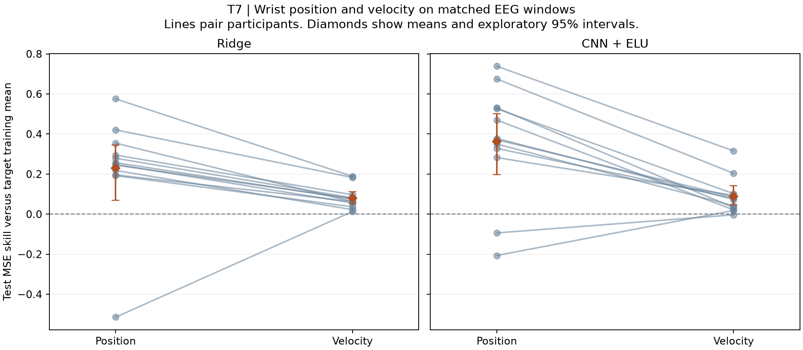

# EXP-040 / T7 — Wrist position and velocity decoding

P1–P12, separately fitted within each participant. The verified T1 2 ms position fits and new velocity fits use identical EEG windows, timestamps and series splits. Each model is compared with the training mean of its own target. Positive skill means the model beats that reference.

## Held-out performance on series 8–9

| Model | Target | Mean skill | Exploratory 95% interval | Beat training mean | Mean R² X / Y / Z |
| --- | --- | ---: | ---: | ---: | --- |
| Ridge | Position | 0.230 | [0.068, 0.346] | 11/12 | 0.065 / -0.015 / 0.097 |
| Ridge | Velocity | 0.080 | [0.052, 0.112] | 12/12 | 0.096 / 0.117 / 0.039 |
| CNN + ELU | Position | 0.362 | [0.198, 0.501] | 10/12 | 0.220 / 0.163 / 0.260 |
| CNN + ELU | Velocity | 0.089 | [0.046, 0.142] | 11/12 | 0.108 / 0.130 / 0.039 |

## Paired differences and zero-velocity reference

- **Ridge.** Mean velocity-minus-position skill -0.151 (95% [-0.243, -0.010]). Velocity had higher skill in 1/12 participants. Against zero velocity, mean skill was 0.080 and 12/12 beat the reference.
- **CNN + ELU.** Mean velocity-minus-position skill -0.274 (95% [-0.383, -0.137]). Velocity had higher skill in 2/12 participants. Against zero velocity, mean skill was 0.089 and 11/12 beat the reference.

## Scope

The velocity label is the signed derivative of the wrist trace. It uses a 41-sample cubic Savitzky–Golay filter evaluated separately within each recording series. Its interior support includes 40 ms of observed kinematics on either side of the target time. Series-local edge evaluation was used for 26 training, 7 validation and 11 test target times.

Each participant has equal weight in the means and bootstrap. Both targets were scaled from their own training series. Skill values compare performance relative to different targets’ training-mean references. Differences in signal dynamics and label noise also affect these scores. The analysis uses one CNN seed and one derivative definition on familiar held-out series.

## Verification

Rebuilt 304,428 velocity target times, replayed 72 velocity validation fits and 24 reused position test fits, and checked 252 test metric sets. 0 velocity ridge axis fits reached the iteration cap.

[Declared protocol](declared_protocol.md) · [Participant metrics](participant_metrics.csv) · [Verification](verification.json) · [Population summary](population_summary.json)
