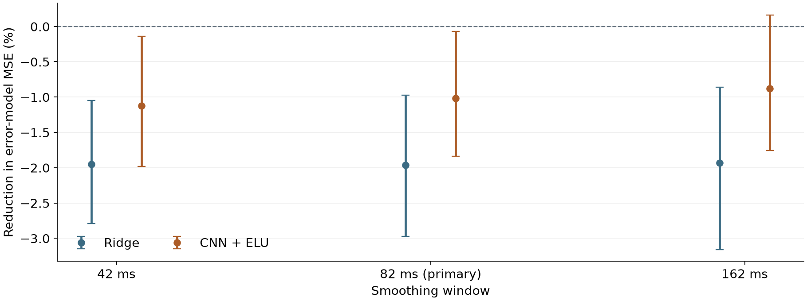
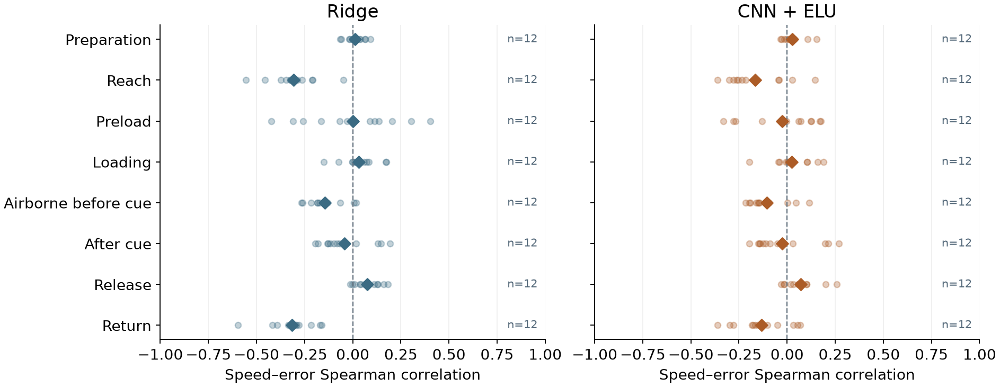

# R6 — Population error explanation

P1–P12, ridge and CNN + ELU saved 2 ms wrist predictions, 36,811 event-aligned targets in 804 trials. The event coverage reproduces the existing population streak analysis. Kinematic errors use reduced coordinates.

For each participant and decoder, error explainers fit on series 8 and score on 9, then reverse. Trials contribute equally within participant. CNN seed metrics are averaged before participants are weighted equally. The percentile intervals resample participants and are exploratory.

| Decoder | P + stage MSE | Add dynamics MSE | Change | Exploratory 95% interval | Improved |
| --- | ---: | ---: | ---: | ---: | ---: |
| Ridge | 0.036514 | 0.036978 | +0.000465 | [+0.000048, +0.000823] | 1/12 |
| CNN + ELU | 0.041899 | 0.042291 | +0.000391 | [+0.000080, +0.000675] | 2/12 |

The predictors of error are observed wrist position and stage, with optional velocity, acceleration and jerk. The primary 82 ms contrast adds velocity and acceleration. The stage plots are descriptive within-stage rank correlations. The speed table uses medians across participant estimates, with at least five trials per group in every fit.

[Participant error models](participant_error_models.csv) · [Streak speeds](participant_streak_speeds.csv) · [Stage correlations](participant_stage_correlations.csv) · [Summary](population_summary.json)
