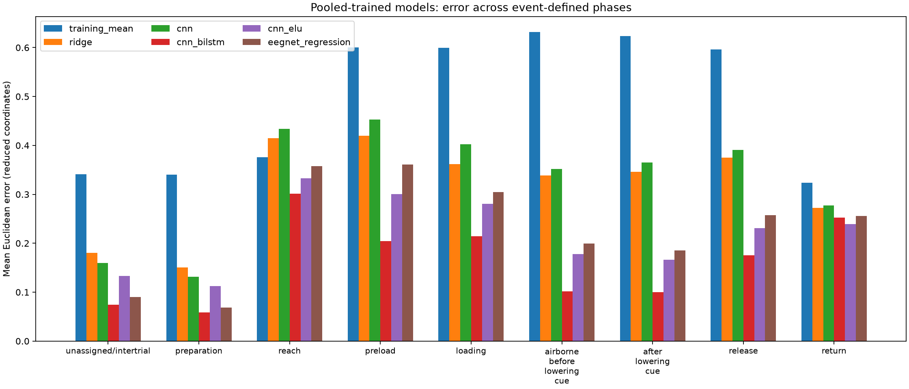
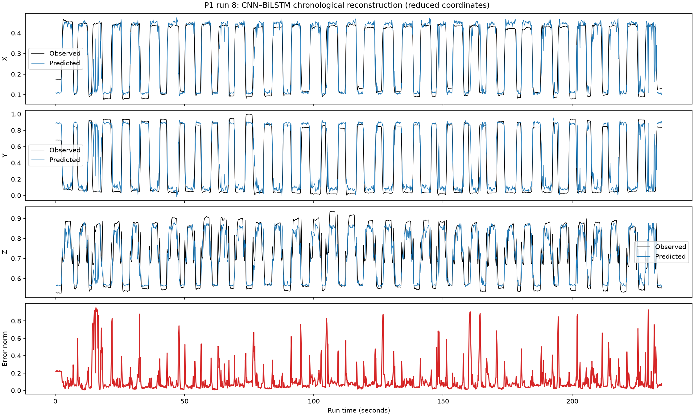
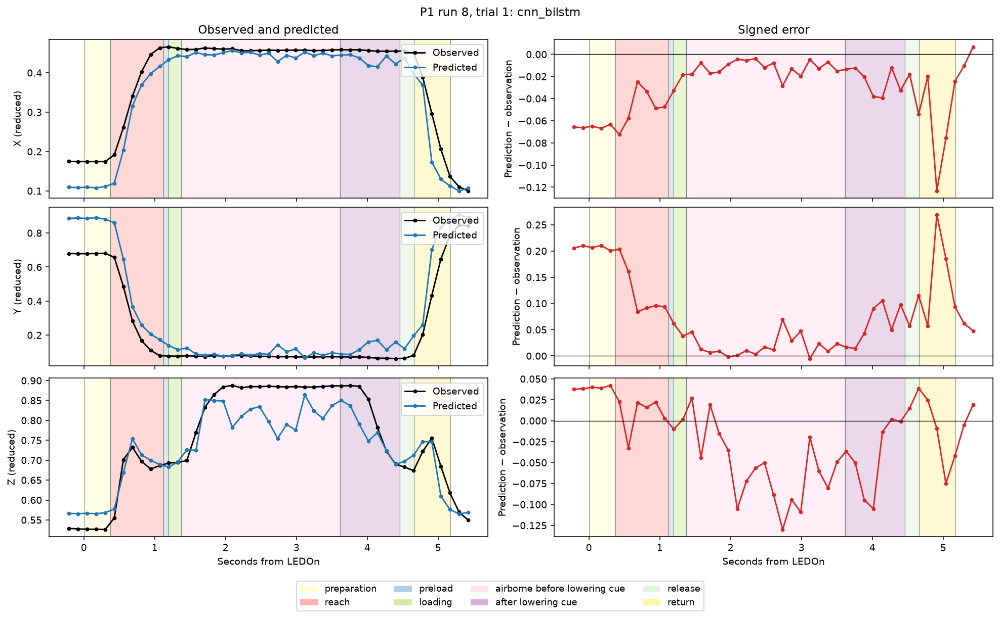
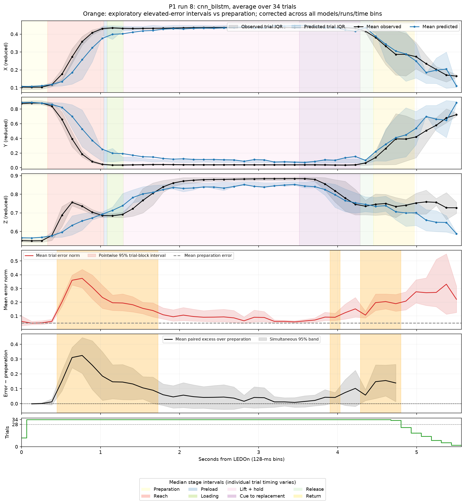
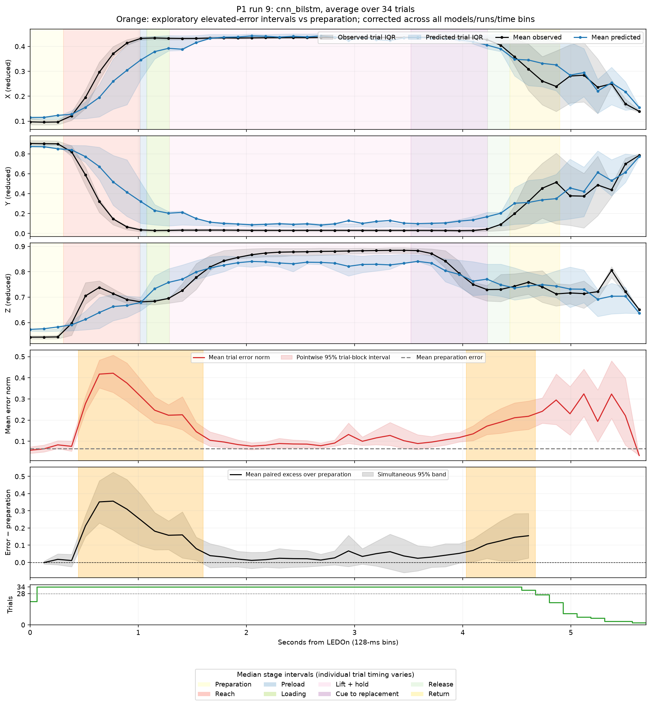
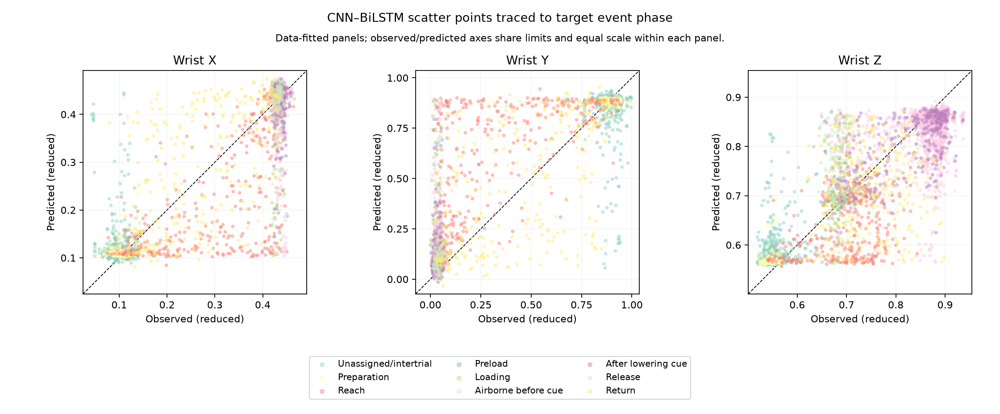

# Project Idea Category 2: Additional Results from Existing Decoders

P1 analysis of R1–R5 from the [project ideas backlog](../../documentation/PROJECT_IDEAS.md).

No models were trained or predictions regenerated. Six P1 reference models use held-out runs 8–9.
R1 reconstructs saved target samples; R2 plots coordinates and signed error versus time; R3 reports bias/phase errors and a descriptive lag scan; R4 traces scatter-density regions; R5 compares low-speed and moving samples.

## Alignment and stage definitions

Raw HS and WS EEG and wrist samples match exactly for all 68 held-out trials. The AllLifts/WS time origin is 2 seconds later than the continuous HS origin in these files; the offset is inferred from exact EEG matching and validated for every trial.
Times on plots use the verified continuous clock. This conversion must not be replaced by blindly adding StartTime to trial-relative events.
Stages are preparation, reach, preload, loading, airborne before lowering cue, after lowering cue, release, and return. Airborne includes both lifting/holding; the cue interval includes reaction time. Unassigned/intertrial samples are retained and not automatically called rest.
Phase refers to the target sample. Separate pure-window metrics require all 128 EEG samples and the target to share that phase. Short stages can have few or no pure windows.

## Phase error (mean Euclidean distance in reduced coordinates)

**Time reference: LEDOn = 0 s in each trial.** The typical intervals below use
the median event times across the 68 trials. They illustrate stage timing;
the error metrics use each trial's own event boundaries, not these median bins.
Intervals are start-inclusive and end-exclusive: `[start, end)`. Units are
**seconds** (0.25 s = 250 ms).

| Stage | Event boundaries | Wrist motion by design | Typical interval (s from LEDOn) | Samples | CNN–BiLSTM | CNN + ELU | EEGNet |
|---|---|---|---|---:|---:|---:|---:|
| unassigned/intertrial | Outside LEDOn → hand-stop intervals | Not specified by these stage boundaries | No single trial-relative interval | 985 | 0.0744 | 0.1335 | 0.0898 |
| preparation | LEDOn → hand start | Stationary, awaiting movement onset | [0.000, 0.322) | 183 | 0.0589 | 0.1121 | 0.0682 |
| reach | Hand start → first digit touch | Moving toward the object | [0.322, 1.030) | 370 | 0.3014 | 0.3328 | 0.3580 |
| preload | First digit touch → load-phase onset on both digits | Mostly stationary; establish grip | [1.030, 1.081) | 30 | 0.2047 | 0.3003 | 0.3606 |
| loading | Load-phase onset on both digits → lift-off | Mostly stationary; build force before lift-off | [1.081, 1.290) | 124 | 0.2146 | 0.2808 | 0.3046 |
| airborne_before_lowering_cue | Lift-off → LEDOff | Mixed: lift, then hold stationary | [1.290, 3.519) | 1189 | 0.1016 | 0.1782 | 0.1996 |
| after_lowering_cue | LEDOff → object replacement | Mixed: reaction delay, then lower the object | [3.519, 4.262) | 393 | 0.0999 | 0.1662 | 0.1851 |
| release | Object replacement → both digits released | Mostly stationary wrist; release the grip | [4.262, 4.449) | 98 | 0.1752 | 0.2305 | 0.2570 |
| return | Both digits released → hand stop | Moving back to the starting position | [4.449, 4.930) | 270 | 0.2525 | 0.2390 | 0.2555 |

“By design” describes the intended wrist behavior, not measured zero velocity;
finger movements and small wrist adjustments can still occur.

**Unassigned/intertrial** samples fall mainly between the previous hand stop
and the next LEDOn—before `t = 0` of the upcoming trial. They also include the
recording edges before the first LEDOn and after the final hand stop. This
timing category does not necessarily mean rest.

### Trial averages for each run

Each plot averages **34 trials aligned to LEDOn**, in 128-ms bins. The error
curve averages each trial's error magnitude, so opposite errors do not cancel.
Stage backgrounds show median event times; individual trials vary.

**Orange regions** have reliably higher error than each trial's own preparation
baseline: exploratory simultaneous 95% trial-block bootstrap bands, corrected
across time bins, all six model outputs and both runs. Only bins supported by
at least 28/34 trials are tested. This is not a test against zero error.

For CNN–BiLSTM, **0.448–1.600 s after LEDOn** is elevated in both runs and remains
so with trial-block sizes 2, 4 and 8. Later intervals are also highlighted;
some run 9 late bins are sensitive to block size. These identify difficult
times for the existing decoder, not proof that separate stage decoders are needed.

[All models, interval tables and statistical details](trial_averages/RESULTS.md).

## Stationary/moving and density diagnostics

Velocity comes from the observed reduced coordinates with fixed local polynomial smoothing. Primary exploratory settings: 42-ms smoothing, speed threshold 0.02 reduced units/s. Sensitivity covers 22/42/82-ms smoothing and thresholds 0.01/0.02/0.05. These are descriptive definitions, not validated physical rest labels.
Dense observed-position regions are the five most occupied bins in each axis, using 50 bins over 0–1 and training runs 1–6 only. A separate descriptive scatter audit uses the ten most occupied held-out 2D observed/predicted cells with 0.02-wide bins. Both definitions and their fractions, speed composition, stage counts and inside/outside errors are in results.json. Neither definition itself proves resting positions.

## Files and limits

aligned_predictions.csv retains source target indices, verified times, phases, observed/predicted coordinates, errors and speed. phase_metrics.csv contains all-target/pure-window errors, bias and per-axis metrics; trial_metrics.csv contains individual-trial summaries. results.json includes sensitivity analyses and lag diagnostics. trial_events.json records event boundaries.
Plots use saved predictions spaced 128 ms apart. Lines connect decoded samples for viewing; they do not provide additional decoded time points. Errors use reduced coordinates, not physical distance. Stage-wise R² can be unstable when target variance is small.
Stage comparisons here use pooled-trained decoders. They identify difficult intervals but cannot yet establish the benefit of a stage-specific decoder or distinct neural populations. A cross-stage training/evaluation matrix is a subsequent C5 experiment.
Event metadata source: https://github.com/luciw/way-eeg-gal-utilities/blob/master/Utilities/WEEG_GetEventsInHS.m. The local files additionally require the empirically verified time-origin conversion.

## Initial findings for the six-model CNN–BiLSTM

Mean error is higher during reach (0.3014) and return (0.2525) than preparation (0.0589) and the airborne interval (0.1016), in reduced-coordinate Euclidean units. These are descriptive pooled-model errors, not evidence that separate decoders are already necessary.
Pure-window counts matter: preload has none; loading has 26 and release only four. Phase labels based on targets can otherwise mix earlier-stage EEG into a later-stage prediction.
At the primary exploratory speed threshold, 23.8% of targets are low speed. Low-speed mean error is 0.0778 versus 0.1464 for moving targets. This does not establish that most samples are at rest.
The aggregate signed Y bias is +0.0633 reduced units; X and Z biases are −0.0038 and −0.0073. The time plots show whether these offsets persist during particular stages.

| Speed threshold (reduced units/s, 42-ms smoothing) | Low-speed fraction | Low-speed error | Moving error |
|---|---:|---:|---:|
| 0.01 | 7.4% | 0.0761 | 0.1344 |
| 0.02 | 23.8% | 0.0778 | 0.1464 |
| 0.05 | 51.0% | 0.0804 | 0.1818 |

| Axis | Dense 2D-scatter fraction | Low-speed fraction within dense cells | MAE inside | MAE outside |
|---|---:|---:|---:|---:|
| X | 71.9% | 30.0% | 0.0133 | 0.0935 |
| Y | 40.3% | 32.4% | 0.0366 | 0.1494 |
| Z | 45.5% | 37.7% | 0.0224 | 0.0709 |

Next: inspect these traces and phase/sample coverage before choosing C5 stage-specific training. Any difficult-stage claim should control for target variance, condition, trial composition and window overlap with preceding phases.

## Trial-level consistency and verification

For CNN–BiLSTM, reaching has greater trial-mean error than the airborne interval
in 62/68 trials; return has greater error in 64/68. Median trial-mean errors are
0.2573 (reach), 0.2478 (return), 0.0504 (preparation) and 0.0798 (airborne).
`trial_phase_errors.csv` and `trial_phase_summary.json` retain those per-trial
summaries. They are descriptive consistency checks within two P1 runs, not
independent-window significance tests or a demonstration of distinct neural routines.

[Independent verification](verification.json) checks all 21,852 aligned rows
across six model outputs, 60 aggregate/phase metric subsets, pure-window
counts, 68 trial-window clock matches, source prediction hashes and the analysis
snapshot hash. Source predictions are unchanged.
