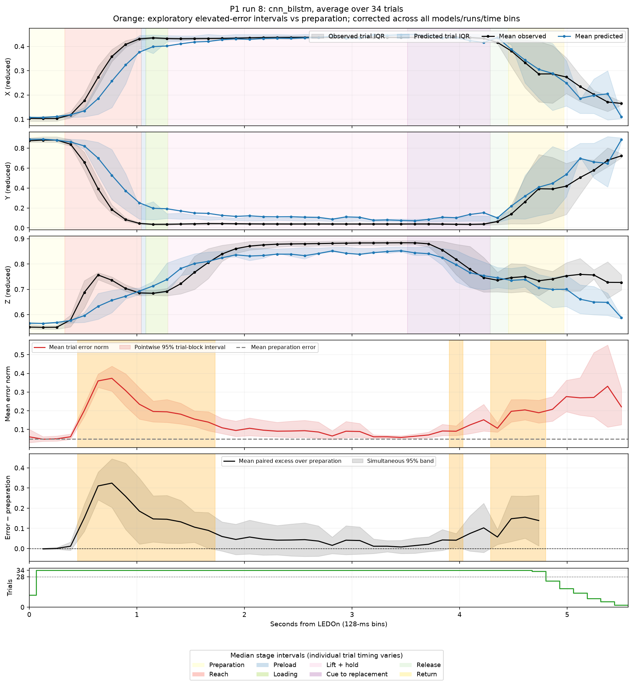
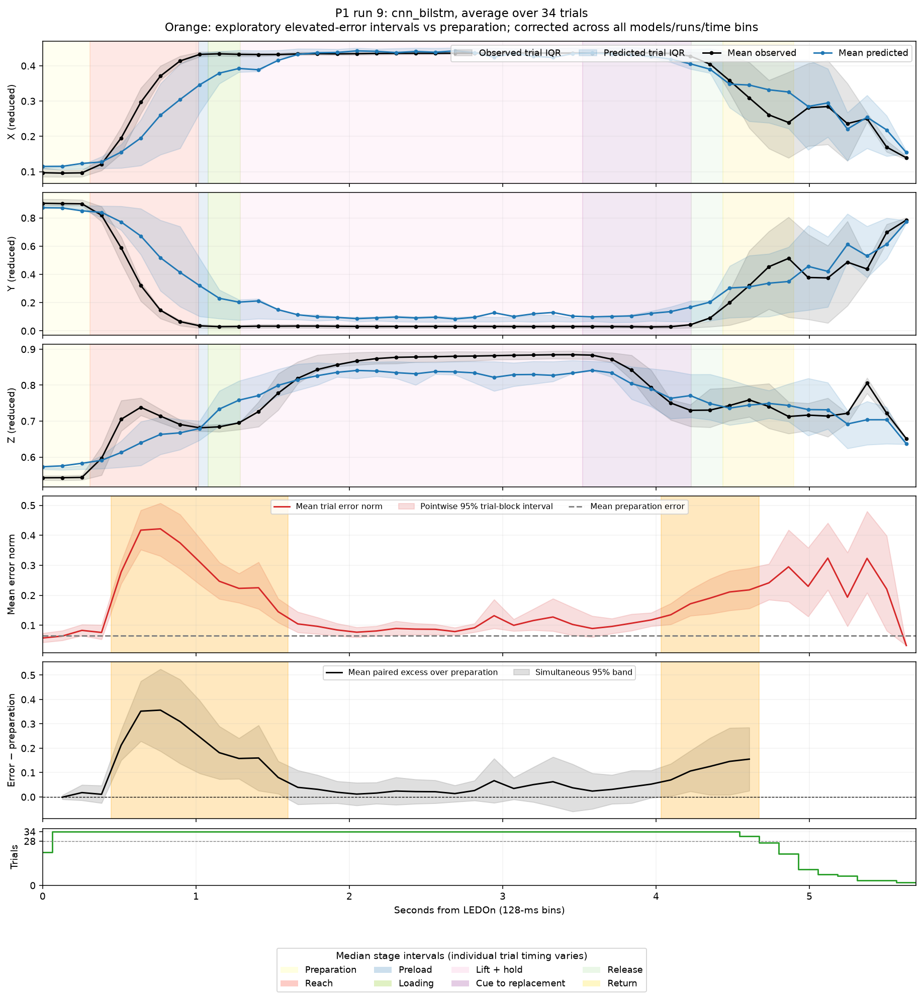

# LEDOn-aligned trial averages

Each run contributes 34 held-out P1 trials. Existing run-wide and individual-trial plots are retained.
Coordinates are trial means; shading shows across-trial interquartile ranges. Error is the mean of individual prediction error norms, so opposite signed errors cannot cancel.
Original predictions are assigned to nearest 128-ms LEDOn-relative bins. No new inference, interpolation or extrapolation occurs. Median event boundaries are guides, not identical stage timings for all trials.

## Exploratory elevated-error intervals

For each trial/model, subtract its own mean preparation-period error. Orange regions have a simultaneous 95% lower confidence bound above zero, using circular moving-block bootstrap over consecutive trials (block size 4). The maximum standardized bootstrap deviation corrects jointly across eligible bins, all six model outputs and both runs. Only bins supported by at least 28/34 trials are tested.
This tests higher error than preparation, not greater-than-zero error or the need for separate stage decoders. It is an exploratory analysis of one participant. Block sizes 2 and 8 provide sensitivity checks.

| Run | Model | Seconds from LEDOn | Minimum trials | Mean excess error | Positive throughout at blocks 2, 4 and 8? |
|---|---|---|---:|---:|---|
| 8 | training_mean | [0.704, 4.544) | 34 | 0.2776 | Yes |
| 8 | ridge | [0.448, 1.728) | 34 | 0.1795 | Not every bin |
| 8 | ridge | [1.856, 1.984) | 34 | 0.1137 | Yes |
| 8 | ridge | [2.112, 2.368) | 34 | 0.1212 | Yes |
| 8 | ridge | [2.496, 2.752) | 34 | 0.1133 | Yes |
| 8 | ridge | [2.880, 3.392) | 34 | 0.1151 | Not every bin |
| 8 | ridge | [3.776, 4.672) | 34 | 0.1410 | Not every bin |
| 8 | cnn | [0.448, 4.800) | 33 | 0.1809 | Yes |
| 8 | cnn_bilstm | [0.448, 1.728) | 34 | 0.1852 | Not every bin |
| 8 | cnn_bilstm | [3.904, 4.032) | 34 | 0.0415 | Yes |
| 8 | cnn_bilstm | [4.288, 4.800) | 33 | 0.1249 | Yes |
| 8 | cnn_elu | [0.576, 1.856) | 34 | 0.1709 | Yes |
| 8 | cnn_elu | [4.288, 4.800) | 33 | 0.1130 | Yes |
| 8 | eegnet_regression | [0.448, 4.800) | 33 | 0.1493 | Yes |
| 9 | training_mean | [0.704, 4.416) | 34 | 0.2650 | Yes |
| 9 | ridge | [0.448, 4.672) | 31 | 0.2701 | Yes |
| 9 | cnn | [0.448, 4.672) | 31 | 0.3018 | Yes |
| 9 | cnn_bilstm | [0.448, 1.600) | 34 | 0.2285 | Yes |
| 9 | cnn_bilstm | [4.032, 4.672) | 31 | 0.1206 | Not every bin |
| 9 | cnn_elu | [0.448, 1.856) | 34 | 0.2216 | Yes |
| 9 | cnn_elu | [4.032, 4.672) | 31 | 0.1165 | Yes |
| 9 | eegnet_regression | [0.448, 4.672) | 31 | 0.1936 | Yes |

## CNN–BiLSTM averages

## Files and limitations

summary.json records the reference, bootstrap settings, multiplicity family, coverage and interval endpoints. average_curves.csv contains mean curves and simultaneous bands. Trial arrays remain local in trial_arrays.npz. Plots are also available for the other five saved outputs.
Pointwise intervals on the mean-error panel describe uncertainty in the mean. Only the simultaneous paired-excess band determines orange highlighting.
Changing trial duration/weight can affect the average and blur late phases. Preparation estimates can use few source points. Consecutive-trial resampling assumes approximate local stationarity; block-size sensitivity does not establish that assumption. These plots are not stage-trained decoder comparisons, population inference, or proof of different neural routines.
