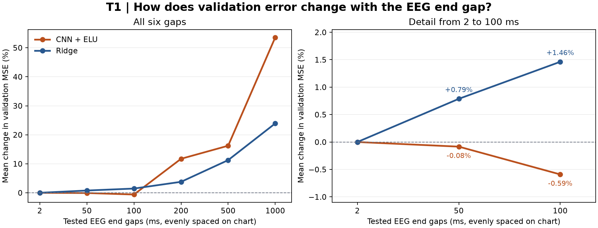
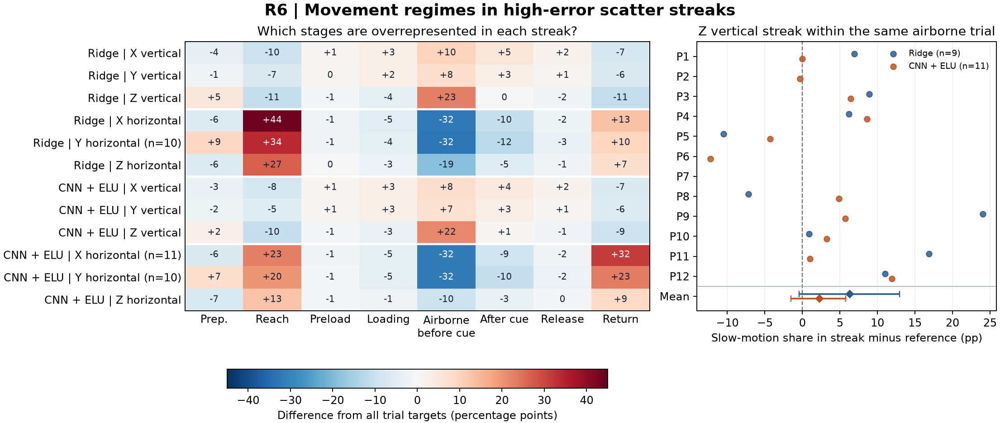

# T1 and R6 population follow-up

## T1 validation error at each end gap

Mean of each participant’s percentage change from their own 2 ms validation MSE. Ridge uses the validation-selected penalty at each gap. CNN + ELU averages the three seed MSEs within participant before computing relative change. Positive values mean higher error.

| Model | 2 ms | 50 ms | 100 ms | 200 ms | 500 ms | 1,000 ms |
| --- | ---: | ---: | ---: | ---: | ---: | ---: |
| Ridge | +0.00% | +0.79% | +1.46% | +3.78% | +11.26% | +23.92% |
| CNN + ELU | +0.00% | -0.08% | -0.59% | +11.72% | +16.22% | +53.58% |

The verified held-out comparison concerns a different decision. Selecting one gap per participant on validation reduced CNN + ELU mean test MSE from 0.7997 to 0.7723 (−3.42%). Ridge mean test MSE rose from 0.8970 to 0.9233 (+2.93%). All six gaps were evaluated on validation. Held-out scoring covered the selected gap and 2 ms reference.

## R6 movement regimes in the scatter streaks

P1–P12, series 8–9, verified T1 2 ms ridge and CNN + ELU predictions on identical target times. All 816 trial clocks aligned. 12 trials were excluded for invalid event order. There were 36,811 eligible event-assigned targets in 804 trials. The original P1 R6 lead decoder was CNN–BiLSTM.

A vertical streak is high error with only the observed position in a frequent training position bin. A horizontal streak is high error with only the predicted position in such a bin. The original R6 region rules were reused. Stage enrichment compares the share of each stage in the streak with its share among all eligible trial targets for the same participants. Trials have equal starting weight. CNN seed shares are averaged before giving each participant equal weight. The profile CSVs give direction, speeding-up and slowing-down results, as well as slow motion and stage composition.

### Does the Z-axis slow-motion association persist within a stage?

The primary comparison pairs Z vertical-streak targets with other targets from the same trial, same airborne stage (lift-off to lowering cue), and same frequent-observed-bin category. The wider reference uses all other targets from that trial and stage. A trial must contain both groups. Each seed requires at least five paired trials for a participant to contribute. Trial shares are averaged per fit, then across seeds within participant, then across participants. Positive values mean the streak contains more slow motion. The intervals resample participants and are exploratory.

| Model | Reference | Smoothing | Participants | Streak slow | Reference slow | Difference (pp) | 95% interval (pp) |
| --- | --- | ---: | ---: | ---: | ---: | ---: | ---: |
| Ridge | Same stage and frequent-position category | 82 ms | 9 | 28.5% | 22.2% | +6.3 | [-0.5, +13.0] |
| Ridge | Same stage and frequent-position category | 42 ms | 9 | 27.2% | 19.8% | +7.4 | [+0.4, +14.5] |
| Ridge | Same stage and frequent-position category | 162 ms | 9 | 39.8% | 30.5% | +9.3 | [-1.0, +18.0] |
| CNN + ELU | Same stage and frequent-position category | 82 ms | 11 | 28.2% | 25.9% | +2.3 | [-1.5, +5.8] |
| CNN + ELU | Same stage and frequent-position category | 42 ms | 11 | 26.5% | 24.1% | +2.4 | [-1.2, +5.7] |
| CNN + ELU | Same stage and frequent-position category | 162 ms | 11 | 35.9% | 33.7% | +2.2 | [-2.6, +6.6] |
| Ridge | Same stage | 82 ms | 11 | 22.4% | 15.9% | +6.6 | [-0.4, +13.8] |
| Ridge | Same stage | 42 ms | 11 | 21.3% | 14.8% | +6.5 | [-0.0, +13.4] |
| Ridge | Same stage | 162 ms | 11 | 28.1% | 19.5% | +8.6 | [-0.2, +17.9] |
| CNN + ELU | Same stage | 82 ms | 11 | 23.3% | 18.3% | +4.9 | [-0.7, +11.0] |
| CNN + ELU | Same stage | 42 ms | 11 | 22.0% | 17.3% | +4.7 | [-0.7, +10.4] |
| CNN + ELU | Same stage | 162 ms | 11 | 29.0% | 22.8% | +6.2 | [-1.3, +13.9] |

Across all trial stages, slow motion was 11.5 percentage points more common in the CNN + ELU Z vertical streak than among all eligible targets, and 12.5 points more common for ridge. For both decoders, the airborne stage before the lowering cue was also overrepresented by more than 20 points. Within the same airborne trial and frequent-position category, the estimated excess was +2.3 points for CNN + ELU and +6.3 for ridge. Both primary intervals include zero. The overall enrichment and the matched contrasts summarize different target subsets.

The matched comparison adjusts for trial, stage and membership in a frequent observed-position bin. Individual bin identity and position within a bin can still differ. The geometry is defined using prediction error, and the associations are descriptive. Speed is measured from symmetric smoothing of observed kinematics in reduced coordinates. Slow means speed ≤0.02 reduced units/s. The intervals condition on the saved model fits, split and thresholds.

[Population profiles](population_profiles.csv) · [Seed profiles](seed_profiles.csv) · [Matched trials](paired_airborne_trials.csv) · [Participant summaries](paired_airborne_participants.csv) · [Clock and event coverage](alignment.json)

Reproduction uses the two source files in this folder. From the project repository, run r6_population_followup.py with a fresh output directory as its argument. Then run report_t1_r6_followup.py with the repository and output directory as its two arguments.
