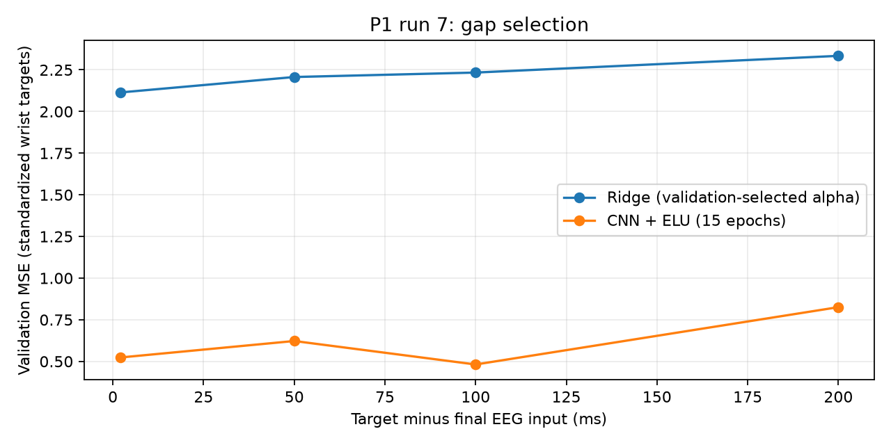
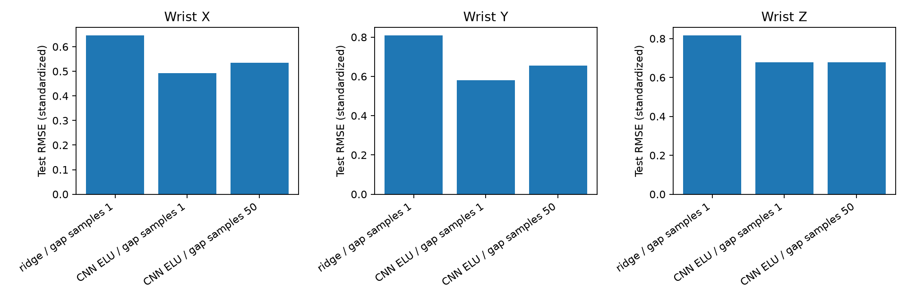
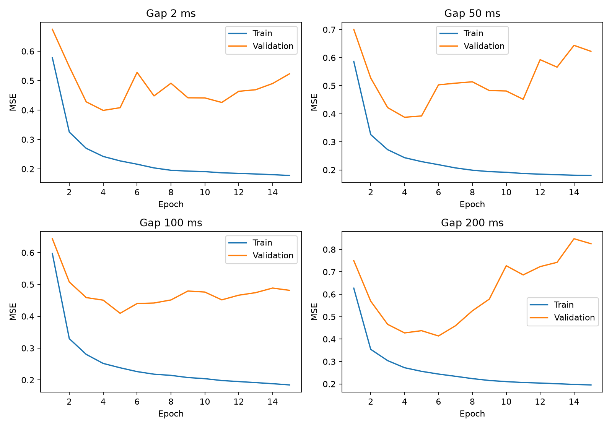
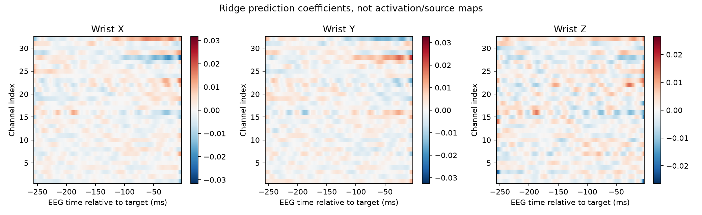

# EXP-012: P1 EEG-to-kinematics timing alignment

Completed 2026-10-27T12:07:47.836076+00:00. Single participant and seed; exploratory reuse of historical test runs.

## Finding and next decision

This pilot provides **no evidence to adopt an earlier-ending window as an improved P1 decoder under the declared primary MSE criterion**. Ridge selected the existing 2-ms gap. CNN + ELU selected 100 ms from validation: validation mean MSE fell by 8.0%, but its test mean MSE rose from 0.345976 to 0.391484 (**13.15% higher**) on identical targets. Both test runs show higher CNN MSE at 100 ms.

The frozen selection remains 100 ms for CNN in this experiment; it is not replaced after seeing test results. The 2-ms decoder remains the existing reference, without a claim that its physiological alignment is optimal. One validation run and one neural seed limit conclusions about the full timing problem. Additional checkpoint, seed or lag searches would be separate experiments, not retroactive changes to this result.

Stage effects are heterogeneous. The selected CNN improves preparation and unassigned/intertrial prediction errors, while reach, preload/loading, lift/hold, lowering-cue and return MSE are higher. Release MSE is slightly lower. Its aggregate mean error norm can improve while MSE worsens, so the declared primary metric matters. Trial-mean error norms over the 68 event-defined trials worsen by 0.119258 standardized units on average. These are descriptive comparisons; unassigned/intertrial is not a validated rest label.

**Next queued experiment:** EXP-013, retrospective movement-stage classification using shrinkage LDA and CNN plus a timing-only control. C5 and C3 follow in the agreed order. No later experiment was started here.

## Validation selection

| End gap (ms) | Ridge validation MSE | Ridge alpha | CNN + ELU validation MSE |
|---|---:|---:|---:|
| 2 | 2.114237 | 1 | 0.523412 |
| 50 | 2.206994 | 100 | 0.622504 |
| 100 | 2.233698 | 1 | 0.481546 |
| 200 | 2.333992 | 100 | 0.825622 |

Lowest mean validation MSE chooses each model's gap; all choices froze before test evaluation. Every gap shares target timestamps. The current 2-ms reference was retrained on the common eligible set.

Common windows: train 18504, validation 1865, test 3638. Train-only transforms match the existing v2 reference exactly.

## Permitted test comparisons

| Model | Gap (ms) | Test MSE | R² X | R² Y | R² Z |
|---|---:|---:|---:|---:|---:|
| ridge | 2 | 0.579599 | 0.5579 | 0.4200 | 0.4608 |
| cnn_elu | 2 | 0.345976 | 0.7427 | 0.7020 | 0.6291 |
| cnn_elu | 100 | 0.391484 | 0.6977 | 0.6201 | 0.6278 |

## Target-stage CNN comparison

These metrics assign phase from the target timestamp. Inputs may span an earlier phase, especially at larger gaps; pure-context counts and metrics are separate in results.json.

| Target phase | Targets | 2-ms MSE | 100-ms MSE |
|---|---:|---:|---:|
| unassigned/intertrial | 981 | 0.305583 | 0.109975 |
| preparation | 183 | 0.266543 | 0.059226 |
| reach | 370 | 0.465043 | 0.868598 |
| preload | 30 | 0.420156 | 0.844923 |
| loading | 124 | 0.465347 | 0.667842 |
| airborne_before_lowering_cue | 1189 | 0.338853 | 0.467260 |
| after_lowering_cue | 393 | 0.260146 | 0.337322 |
| release | 98 | 0.427268 | 0.401011 |
| return | 270 | 0.447130 | 0.550053 |

## Paired trial differences

Negative selected-minus-baseline differences favor the validation-selected gap. These are descriptive, not independent-window significance tests.
- ridge: 68 trials; mean selected-minus-baseline error norm 0.000000 standardized units.
- cnn_elu: 68 trials; mean selected-minus-baseline error norm 0.119258 standardized units.

Per-run, target-stage and pure-context metrics are in results.json. Trial differences are in paired_trial_errors.csv. The exact executed protocol and source snapshots are retained. Weights/predictions stay local under Git ignore rules.

[Declared protocol](../../documentation/methods/TIMING_ALIGNMENT.md) · [Registry](../../documentation/EXPERIMENT_REGISTRY.md)

The experiment does not establish an optimal physiological delay, causal preprocessing, statistical significance, or participant generalization. No stage classifier, stage-specific regressor or condition-specific regressor was trained.

## Independent verification

[Verification record](verification.json): source/input/protocol hashes, training-only scaler statistics, common target indices, run boundaries, validation-only gap/alpha selection, 24 validation metric sets, seven saved-weight replay checks, three permitted test configurations, 59 test metric subsets and 136 paired-trial rows passed. No model was trained by the verifier.

The original executed source and protocol snapshots remain unchanged. Some local WSL/Keras wall-time logs showed clock jumps (including negative epoch-duration displays); UTC stamps across processes are not reliable elapsed-time measurements. The frozen selection file, program order and independent validation-selection reconstruction establish the selection procedure. No latency inference is drawn from those console timestamps.
