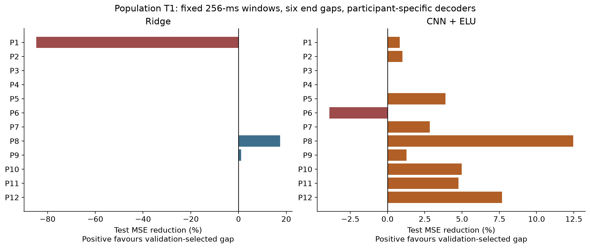
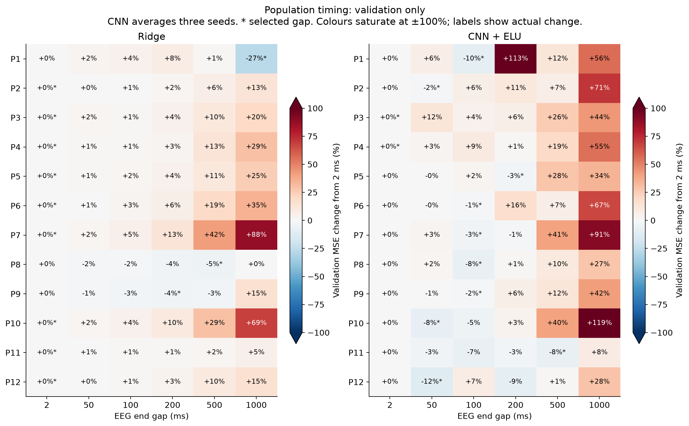
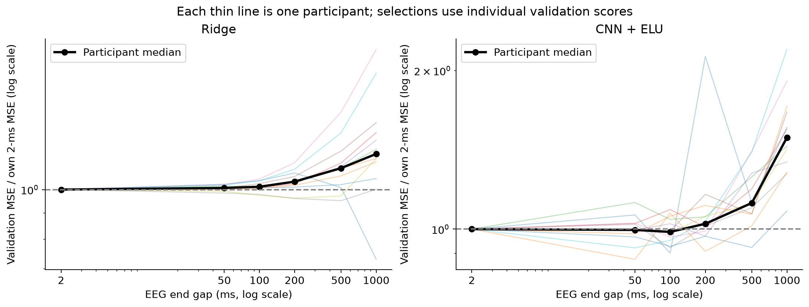
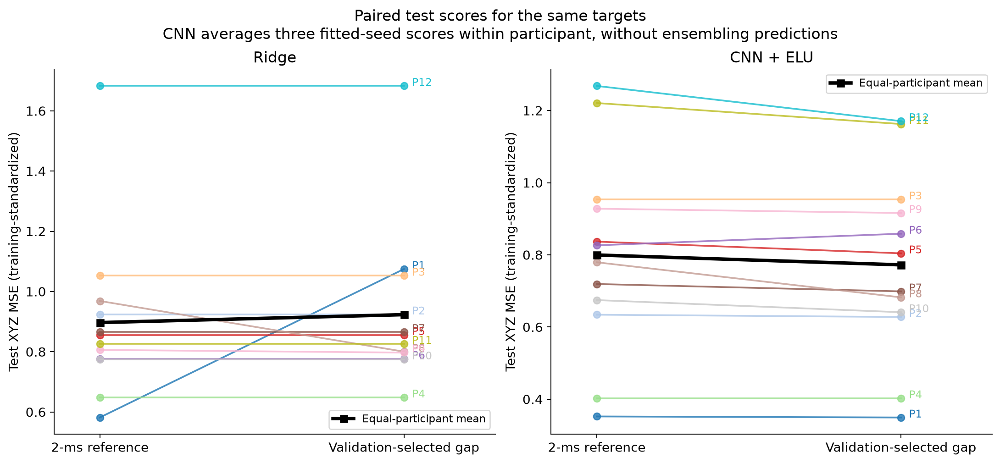
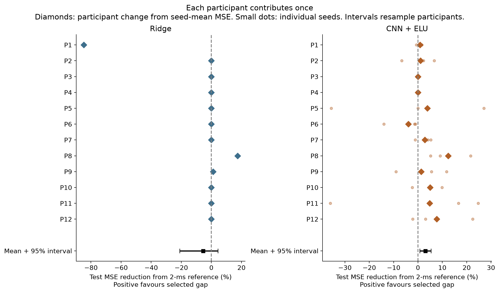
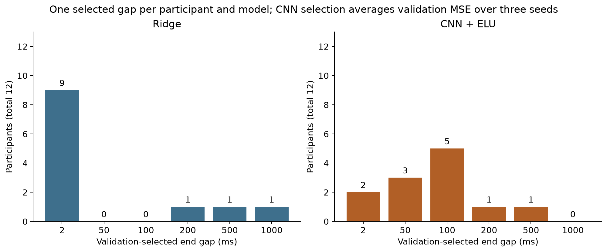
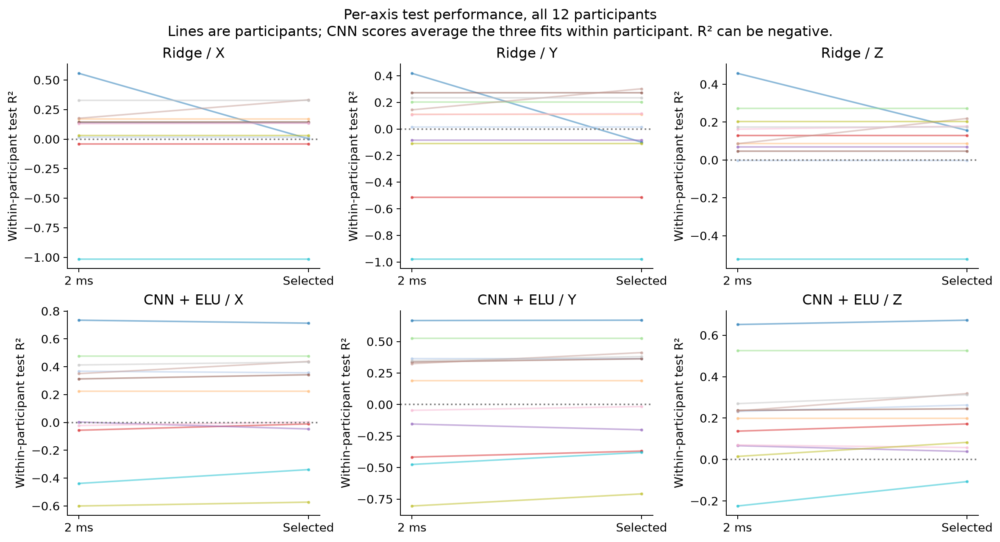

# EXP-042 / T1: population timing alignment

Twelve participant-specific decoders per model, six end gaps, fixed 256-ms EEG inputs. CNN + ELU uses three seeds; ridge uses five validation-selected alpha candidates per gap. All gap choices froze across all participants before new test scoring.

## Population result

Scores average CNN fits within each participant, then give each participant equal weight. These are repeated-fit scores, not an ensemble. Negative paired MSE differences favour the selected gap.

| Model | Mean reference MSE | Mean selected MSE | Mean paired difference | Exploratory 95% interval | Improved / unchanged / worse |
|---|---:|---:|---:|---|---|
| Ridge | 0.896990 | 0.923309 | +0.026319 | [-0.042096, +0.122537] | 2 / 9 / 1 |
| CNN + ELU | 0.799687 | 0.772327 | -0.027360 | [-0.049330, -0.006849] | 9 / 2 / 1 |

Intervals resample the 12 participants, after averaging CNN seeds. They condition on the fitted models and fixed split. They are exploratory and do not establish representativeness of a broader human population. A selected 2-ms gap yields exactly zero change.

## Participant results

### Ridge

| Participant | Selected gap (ms) | Reference MSE | Selected MSE | MSE reduction (%) |
|---|---:|---:|---:|---:|
| P1 | 1000 | 0.581748 | 1.074865 | -84.76 |
| P2 | 2 | 0.924194 | 0.924194 | +0.00 |
| P3 | 2 | 1.052666 | 1.052666 | +0.00 |
| P4 | 2 | 0.648322 | 0.648322 | +0.00 |
| P5 | 2 | 0.855923 | 0.855923 | +0.00 |
| P6 | 2 | 0.776612 | 0.776612 | +0.00 |
| P7 | 2 | 0.865634 | 0.865634 | +0.00 |
| P8 | 500 | 0.968730 | 0.800345 | +17.38 |
| P9 | 200 | 0.806140 | 0.797235 | +1.10 |
| P10 | 2 | 0.774702 | 0.774702 | +0.00 |
| P11 | 2 | 0.826354 | 0.826354 | +0.00 |
| P12 | 2 | 1.682857 | 1.682857 | +0.00 |

### CNN + ELU

| Participant | Selected gap (ms) | Reference MSE | Selected MSE | MSE reduction (%) |
|---|---:|---:|---:|---:|
| P1 | 100 | 0.352215 | 0.349303 | +0.83 |
| P2 | 50 | 0.634188 | 0.627841 | +1.00 |
| P3 | 2 | 0.953620 | 0.953620 | +0.00 |
| P4 | 2 | 0.402649 | 0.402649 | +0.00 |
| P5 | 200 | 0.836768 | 0.804249 | +3.89 |
| P6 | 100 | 0.826424 | 0.858680 | -3.90 |
| P7 | 100 | 0.719254 | 0.698792 | +2.84 |
| P8 | 100 | 0.779441 | 0.682316 | +12.46 |
| P9 | 100 | 0.927957 | 0.916078 | +1.28 |
| P10 | 50 | 0.674697 | 0.641054 | +4.99 |
| P11 | 500 | 1.220824 | 1.162654 | +4.76 |
| P12 | 50 | 1.268209 | 1.170693 | +7.69 |

## Population figures

Validation figures show all six gaps. Test figures show only validation-selected gaps and the matched 2-ms references. Colour saturation in heatmaps does not alter printed values.

## Scope and interpretation

This extends the P1 timing question to within-participant decoding across P1–P12. It does not train a pooled population decoder or test an unseen participant. Training uses series 1–6, validation 7, test 8–9. Test series are weight series at surface code 3 for all participants; generalization to all task conditions is not established.

The end gap changes the EEG history interval, without establishing an optimal physiological delay. Inputs are 128 samples, stride64, at500Hz. Larger gaps can span different movement stages. No phase-specific population claim follows from this report. Training-only channel and target scalers differ by participant. MSE values therefore use each participant’s training-standardized wrist coordinates.

P1 tests and prior transfer results informed planning. The data are exploratory, with a single validation series and partly undocumented upstream preprocessing. The bounded ridge solver and final15-epoch CNN budget remain fixed. No model/seed/gap is retuned from test results. Longer input histories and temporal bins belong to the separately executed EXP-018 / T2 and are outside this fixed-window T1 comparison.

## Numerical evidence

- `results.json`: every candidate validation metric, selected alpha, seed history, scaler and permitted test score.
- `selection.json`: global frozen validation choices.
- `population_summary.json`: participant-first metrics and participant-bootstrap intervals.
- `validation_candidates.csv`, `participant_metrics.csv`, `seed_comparisons.csv`: inspectable tables.
- Participant subdirectories retain local ignored weights, validation predictions, test predictions and common split indices.
- `verification.json`: no-fitting independent input/index/scaler/selection and saved-weight replays.

[Population protocol](../../documentation/methods/POPULATION_TIMING_ALIGNMENT.md) · [Registry](../../documentation/EXPERIMENT_REGISTRY.md)
