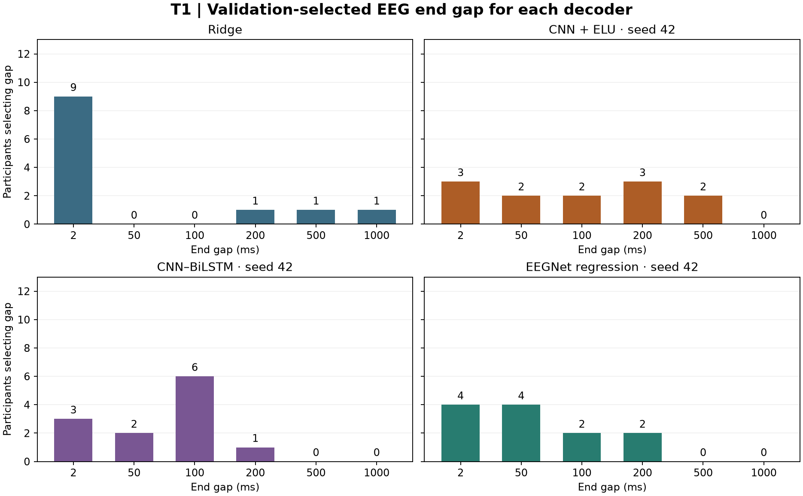

# T1 — Validation gap preferences across decoders

P1–P12, same 256 ms EEG inputs, recording splits and eligible targets as EXP-042. Every cell counts participant-specific choices on validation series 7. Neural model comparisons use seed 42.

| Decoder | 2 ms | 50 ms | 100 ms | 200 ms | 500 ms | 1,000 ms | Most frequent gap |
| --- | ---: | ---: | ---: | ---: | ---: | ---: | --- |
| Ridge | 9 | 0 | 0 | 1 | 1 | 1 | 2 ms |
| CNN + ELU | 3 | 2 | 2 | 3 | 2 | 0 | 2 ms, 200 ms |
| CNN–BiLSTM | 3 | 2 | 6 | 1 | 0 | 0 | 100 ms |
| EEGNet regression | 4 | 4 | 2 | 2 | 0 | 0 | 2 ms, 50 ms |
| All four decoders | 19 | 8 | 10 | 7 | 3 | 1 | 2 ms |

CNN + ELU’s earlier three-seed counts, in the same gap order, were 2, 3, 5, 1, 1, 0.

The combined row contains 48 participant–decoder choices. Repeated choices from the same person are dependent. The single neural seed and single validation series limit the precision of the histogram. The choices describe predictive alignment on validation.

Verification checked all 144 new validation prediction arrays and model file hashes, alongside the shared T1 validation indices, saved errors and within-participant initialization hashes.

[Protocol](declared_protocol.md) · [Gap choices and margins](selected_gaps.csv) · [Validation scores](validation_scores.csv) · [Verification](verification.json)
