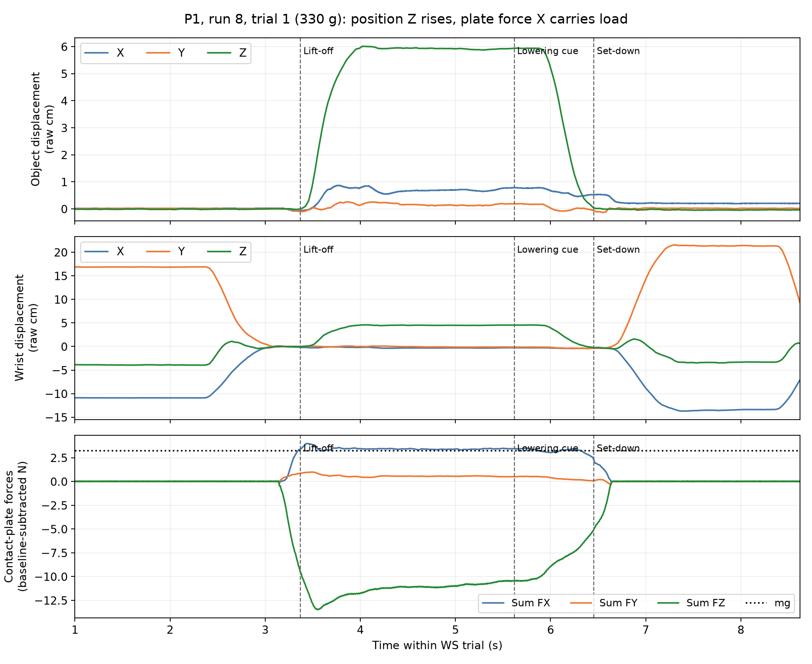

# Vertical-axis verification

Checked 20 October 2026. No model retraining or source-data changes.

**Conclusion: position Z is vertical, positive upward.** The third reduced wrist target corresponds to raw `Pz4`, so it is the vertical position target. Gravity points approximately along negative position Z. X and Y span the horizontal plane; the checked sources do not establish their anatomical forward/lateral directions.

## Explicit source evidence

- [Authors’ event detector](https://github.com/luciw/way-eeg-gal-utilities/blob/master/Utilities/WEEG_FindEvents.m): assigns `Pz1 - position z sensor 1` to `cObjVPos` / `VObjPos` and passes it to `LOC_GetLiftOffReplace`. The function detects a positive height excursion and positive/negative derivatives for lift-off/set-down.
- [Dataset paper](https://doi.org/10.1038/sdata.2014.47), Figure 1 caption: force-sensor X is the lifting/load direction and force-sensor Z is the grip direction. Figure 1a draws FX arrows upward and FZ arrows across the contact surfaces. These force coordinates must not be equated to tracker position coordinates.
- Existing repository [target-provenance documentation](../../documentation/dataset/KINEMATICS_PROVENANCE.md): reduced columns 1/2/3 correspond to wrist `Px4/Py4/Pz4`, with positive affine slopes and raw/reduced correlation verification across P1–P12. Normalized target values are not physical cm.

## Raw trajectory check

All 3,528 available trials across P1–P12, nine runs each. The WS files already contain trial-relative coordinates and timestamps, so this check requires no HS clock offset. Every trial’s start/LED times match AllLifts.

Compare medians in three declared windows: pre-lift `[tLiftOff−0.25, tLiftOff−0.05)` s, held `[LEDOff−0.6, LEDOff−0.2)` s, and after set-down `[tReplace+0.2, tReplace+0.4)` s. Raw position units are cm, consistent with the paper’s plotted position and velocity units.

| Sensor | Axis | Median hold minus pre-lift (cm) | Median after-set-down minus hold (cm) | Positive lift count | Negative lowering count | Largest absolute lift displacement |
|---|---|---:|---:|---:|---:|---:|
| object | X | 0.570 | -0.470 | 3443/3528 | 3444/3528 | 3/3528 |
| object | Y | -0.233 | 0.159 | 508/3528 | 840/3528 | 1/3528 |
| object | Z | 6.244 | -6.250 | 3528/3528 | 3528/3528 | 3524/3528 |
| wrist | X | -0.230 | -0.060 | 712/3528 | 1999/3528 | 2/3528 |
| wrist | Y | -0.436 | 0.514 | 582/3528 | 650/3528 | 2/3528 |
| wrist | Z | 5.229 | -4.916 | 3526/3528 | 3524/3528 | 3524/3528 |

The landmarks were originally detected from object Z. Therefore this is corroboration of the authors’ coordinate convention and sign, not a statistically independent discovery of the vertical axis. Object motion gives cleaner geometric evidence than wrist motion, which can include rotation and horizontal repositioning.

## Force consistency

All samples in all selected trials satisfy `LF = FX1 + FX2` within 0.00002 N. The holding window follows the authors’ convention. Holding load-force medians are compared with nominal weight × 9.80665 m/s² below.

| Nominal mass | Trials | Median holding LF (N) | Nominal mg (N) |
|---|---:|---:|---:|
| 165 g | 1008 | 1.639 | 1.618 |
| 330 g | 1836 | 3.369 | 3.236 |
| 660 g | 684 | 6.641 | 6.472 |

This is a force sanity check, not a calibration result. Grip force can exceed load force, so choosing the largest force component is not a valid method for identifying the gravity axis. The plate frame moves with the object, and exact world-force transformations would require the documented sensor mounting/orientation transform.

## Example trajectory

P1 run 8 trial 1 (330 g), selected by identity before inspecting outcomes. Position traces are relative to the pre-lift median. Plate-force sums are relative to the first-second median.

Detailed values: [results.json](results.json), [trial_displacements.csv](trial_displacements.csv). Exact executed runner: [analysis_source.py](analysis_source.py). Current portable runner: [verify_vertical_axis.py](../../experiments/00_dataset_audits/verify_vertical_axis.py). The separate [example plot source](example_plot_source.py) records the legend-only rendering adjustment. Historical absolute input paths in the numeric source manifest describe the execution location before restructuring; the current runner uses configured data paths.
