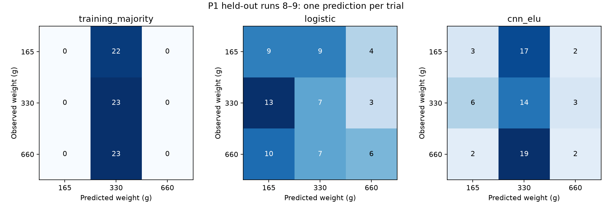
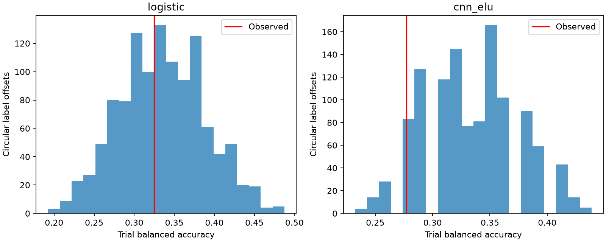
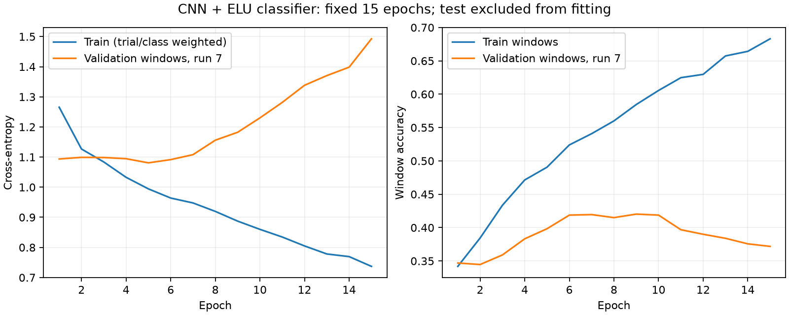

# C2: P1 EEG weight classification at fixed sandpaper

## Finding

This setup does **not** show reliable held-out weight discrimination. Trial
balanced accuracy is 32.48% for logistic regression and 27.73% for CNN + ELU,
against a 33.33% chance reference. Their circular-shift upper-tail fractions
are 0.592 and 0.924; both become 1.0 after adjustment across the two classifiers.
These results concern this representation, training budget and P1 split. They
do not establish that EEG lacks weight information or that other experimental
conditions cannot be decoded.

Logistic validation balanced accuracy is 48.99%, but test performance drops to
32.48%. Its test-run balanced accuracies are 26.52% (run 8) and 38.64% (run 9).
CNN + ELU has 41.41% validation balanced accuracy and test-run values of 25.25%
and 29.80%. Its confusion matrix shows frequent 330 g predictions; per-class
test recalls are 13.64%, 60.87%, and 8.70%. The fixed-epoch learning history
shows rising training accuracy while validation performance deteriorates.
No extra epochs, alternate checkpoint or new settings were selected using test scores.

Train runs 1/4 (68 trials), validate run 7 (34), test runs 8/9 (68). Full LEDOn-to-hand-stop intervals; 128-sample/stride-64 windows stay within trials.
Training-only EEG scaling. Trial/class-balanced training weights. Mean window probabilities produce one trial prediction.

| Model | Trial accuracy | Trial balanced accuracy | Macro F1 | Circular upper-tail fraction | Adjusted across two classifiers |
|---|---:|---:|---:|---:|---:|
| logistic | 0.3235 | 0.3248 | 0.3237 | 0.5917 | 1.0000 |
| cnn_elu | 0.2794 | 0.2773 | 0.2329 | 0.9239 | 1.0000 |
| training_majority | 0.3382 | 0.3333 | 0.1685 | — | — |

Balanced-accuracy chance reference: 1/3. Window-level scores are secondary, not independent sample evidence.
Logistic C=1 uses validation trial balanced accuracy. CNN + ELU uses fixed final epoch 15, seed 42, on GPU.

## Reference and interpretation

All 1,156 within-run trial-label offsets are enumerated with predictions fixed. This measures evaluation-label association, not training under shuffled labels. Circular exchangeability is an assumption, not an established property of these recordings.
Class counts, trial durations, per-run scores, exact clock checks and validation selection are in results.json. No classifier receives kinematics, trial time, run ID or previous-condition metadata as input.

Training/validation/test have 2,609/1,323/2,553 windows. Training and test each
contain 22 trials at 165 g, 23 at 330 g, and 23 at 660 g. Validation contains
12/11/11. Inverse trial-length and class weights give every class equal total
training contribution. Mean window probabilities provide one test prediction
per trial; overlapping windows are not independent test replications.

## Verification

[Independent checks](verification.json) recompute all six saved validation/test
prediction files, 21 metric subsets, 2,312 circular offsets, training-only EEG
scaler statistics, trial/window labels and boundaries, and validation-only C
selection. They also check all 3,528 audited metadata rows and source/snapshot
hashes. All 170 selected trials have raw EEG/wrist clock matches. The declared
protocol and exact executed runner are saved alongside the result; subsequent
plot-contrast changes do not alter those snapshots or any numeric score.

## Limits

- Exploratory single participant and seed, with two training and two test runs.
- Full-trial inference does not imply pre-contact weight anticipation or causal neural encoding.
- Condition-associated movement, EEG artifacts, session drift and repeated conditions may contribute.
- The reduced EEG upstream preprocessing remains undocumented.
- Circular-shift reference preserves trial labels/counts under wrapping but assumes shift-exchangeable alignment.
- Reference permutes evaluation labels only; it is not a full training-label permutation test.
- No C3 condition-specific kinematics models or C5 stage-specific models are fitted.
